# 阶段 2：GPT-2 模型结构

## 导读

[阶段 1 的 tokenizer](01-tokenizer.md#1-tokenizer-的整体结构)负责把文本切成一串 token ID。这一阶段我们把这些编号送进模型，一步步搭出完整的 GPT-2 前向网络：先查表变成向量，再经过多层 Transformer 整合上下文，最后给词表里的每个候选 token 打分。

整套模型代码都在 [gpt2/model.py](../../gpt2/model.py) 里，一共 200 行左右。阅读时可以先看第 1 节的结构图和字母表，再顺着第 2 到第 5 节按代码顺序一块块看；遇到生疏的词，可以直接查文末的[术语表](#附录-术语表)。

## 0 进度与成果

| 小节 | 产出 | 状态 |
|---|---|---|
| 输入嵌入 | `GPT2Embeddings`，用 `wte` 和 `wpe` 合成每个位置的输入向量 | 已完成 |
| 因果自注意力 | `CausalSelfAttention`，让每个位置按权重读取自己和前面位置的信息 | 已完成 |
| Transformer block | `MLP` 和 `TransformerBlock`，用归一化和残差把注意力与 MLP 接起来 | 已完成 |
| 完整模型 | `GPT2`，堆叠多个 block 并用共享权重输出下一个 token 的分数 | 已完成 |

阶段 2 的最终成果：默认配置的参数量精确对齐 GPT-2 124M（**124,439,808** 个参数），改动未来 token 不影响前面位置的 logits，全量 69 项单元测试通过，CPU 与 MPS 实测均正常。

## 1 模型的输入怎么走到输出

每段文本先由 tokenizer 编成一串整数 ID。把多段等长的序列并成一批，就得到形状为 `(B, T)` 的输入张量。接下来数据一路往前走：输入嵌入先把每个编号查表换成一条 `C` 维浮点向量，得到 `(B, T, C)`；随后 `L` 个 Transformer block 逐层更新这些向量，让每个位置既融合上文又提炼自身特征；最后经过 `ln_f` 归一化，再由 `lm_head` 为词表里的 `V` 个候选逐一打分，输出 `(B, T, V)` 的 logits。



图中实线表示前向计算的数据流向，虚线表示 `wte` 这张表同时借给 `lm_head` 做输出打分。[展开看单个 block 的内部结构](#4-transformer-block)

| 方法 | 什么时候用 | 做什么 |
|---|---|---|
| [`GPT2Embeddings.__init__`](#初始化两张查找表) | 创建输入嵌入模块时 | 按词表大小、最大序列长度和向量维度建好两张可训练的查表权重。 |
| [`GPT2Embeddings.forward`](#前向计算怎么查表和相加) | 每次调用输入嵌入模块时 | 把整数 ID `(B, T)` 变成带位置信息的浮点向量 `(B, T, C)`。 |
| [`CausalSelfAttention.__init__`](#初始化注意力的投影层) | 创建注意力模块时 | 算出每个头的宽度，建立 Q/K/V 投影层和输出投影层。 |
| [`CausalSelfAttention.forward`](#前向计算的每一步) | 每次调用注意力模块时 | 在 `(B, T, C)` 上按因果遮罩汇总可见上下文，返回 `(B, T, C)`。 |
| [`MLP.__init__`](#mlp-逐位置处理特征) | 创建 MLP 时 | 建立升维线性层、GELU 激活和降维投影层。 |
| [`MLP.forward`](#mlp-逐位置处理特征) | 每次调用 MLP 时 | 独立变换每个位置的特征，维度从 `C → 4C → C`。 |
| [`TransformerBlock.__init__`](#transformerblock-接入自注意力和-mlp) | 创建 block 时 | 把两份 LayerNorm、自注意力和 MLP 装进同一个模块。 |
| [`TransformerBlock.forward`](#transformerblock-接入自注意力和-mlp) | 每次调用 block 时 | 依次执行注意力分支和 MLP 分支，并把结果各自加回残差主干。 |
| [`GPT2.__init__`](#初始化如何装好完整模型) | 创建完整模型时 | 装配输入嵌入、多个 block、`ln_f` 和 `lm_head`，做好权重共享和深度缩放初始化。 |
| [`GPT2.forward`](#完整模型如何输出-logits) | 每次调用完整模型时 | 把一批 ID `(B, T)` 变成每个位置对词表所有候选的分数 `(B, T, V)`。 |

看张量形状时，例如 `(2, 3, 8)` 表示一批有 2 段序列，每段 3 个位置，每个位置是一条由 8 个数组成的向量。下文统一用这些字母代表各个维度：

| 字母 | 含义 |
|---|---|
| `B` | 批量大小（batch size），一次并行处理多少段序列。 |
| `T` | 当前输入的序列长度，每段有多少个 token。 |
| `V` | 词表大小，共有多少种 token ID。 |
| `P` | 位置表的行数，也就是模型支持的最大序列长度。 |
| `C` | 向量维度，每个位置用多少个数来表示。 |
| `H` | 注意力头数。 |
| `D` | 每个头的向量宽度，等于 `C // H`。 |
| `L` | 完整模型堆叠的 Transformer block 层数。 |

这些类都写在 [gpt2/model.py](../../gpt2/model.py) 里：文件开头引入 `torch` 做张量运算、`from torch import nn` 搭建各个网络层，并用 `math` 计算缩放因子 `sqrt(D)` 和残差初始化系数。

## 2 输入嵌入

### 概念与接口

模型没法直接拿整数编号做加减乘除——编号 `18435` 并不比编号 `5` 「大三千多倍」，它只是词表里的门牌号。所以进入网络的第一步，是把每个整数 ID 换成一条可训练的浮点向量。

但只有 token 向量还不够。固定一个查询，同时打乱它可见的 K、V 配对顺序，加权和保持不变。把整句话里的 token 换序时，各位置的查询和可见前缀也可能变化。GPT-2 选择用两张可训练的查找表，把 token 的身份和它的绝对位置明确加进输入：

- **`wte`（token embedding）**：按 token ID 查行，告诉模型「这里是什么词」。
- **`wpe`（position embedding）**：按位置 `0, 1, ..., T - 1` 查行，告诉模型「它出现在第几个位置」。

把两张表查出来的向量逐项相加，就得到了既包含内容、又包含位置的输入向量。`GPT2Embeddings(vocab_size, max_seq_len, embedding_dim)` 负责这件事，代码在 [gpt2/model.py](../../gpt2/model.py)：

| 名称 | 形状 | 含义 |
|---|---|---|
| `input_ids` | `(B, T)` | `B` 段序列，每段 `T` 个整数 token ID。 |
| `wte.weight` | `(V, C)` | 词表大小 `V` 决定行数，每个 token ID 对应一行。 |
| `wpe.weight` | `(P, C)` | 最大序列长度 `P` 决定行数，位置 `0` 到 `P - 1` 各占一行。 |
| 输出 | `(B, T, C)` | 每个输入位置对应一条由 token 向量和位置向量相加得到的向量。 |

### 初始化两张查找表

```python
class GPT2Embeddings(nn.Module):
    """查出 token 向量和绝对位置向量，并将它们逐项相加。"""

    # 建立两张可训练的查找表。每个 token 一行，每个序列位置也有一行。
    def __init__(
        self, vocab_size: int, max_seq_len: int, embedding_dim: int
    ) -> None:
        """用词表大小 V、最大序列长度 P 和向量维度 C 初始化 embedding。

        wte.weight 的形状是 (V, C)，wpe.weight 的形状是 (P, C)。
        """
        super().__init__()
        self.wte = nn.Embedding(vocab_size, embedding_dim)
        self.wpe = nn.Embedding(max_seq_len, embedding_dim)

        # 沿用原版 GPT-2 的随机初始化，两个表分别使用不同的标准差。
        nn.init.normal_(self.wte.weight, std=0.02)
        nn.init.normal_(self.wpe.weight, std=0.01)
```

1. `class GPT2Embeddings(nn.Module)` 把两张表打包成一个 PyTorch 模块。创建对象时传入 `vocab_size`、`max_seq_len` 和 `embedding_dim`，分别决定 token 表的行数、位置表的行数，以及两张表共有的列数。
2. `super().__init__()` 先初始化父类 `nn.Module`。这样把两个 `nn.Embedding` 挂到 `self` 上之后，PyTorch 会自动把它们的权重登记为模型参数，后面调 `parameters()`、`to(device)` 或保存权重时都不会漏掉。
3. `self.wte = nn.Embedding(vocab_size, embedding_dim)` 建出 token 查表层，里面的实际数字存在 `self.wte.weight`。比如 `V = 4`、`C = 3` 时，它是一张 4 行 3 列的表，ID `2` 对应的就是从 0 数起的第 2 行。
4. `self.wpe = nn.Embedding(max_seq_len, embedding_dim)` 建出位置查表层，用位置编号来查行。因为它的列数也是 `C`，两张表查出来的向量长度完全一致，才能逐项相加。
5. `nn.init.normal_(self.wte.weight, std=0.02)` 和 `nn.init.normal_(self.wpe.weight, std=0.01)` 用均值 0 的正态分布给两张表填入随机初始值。函数名末尾的下划线表示原地修改张量，`std` 控制数值的分散程度；`0.02` 和 `0.01` 沿用 GPT-2 原版实现。[GPT-2 官方实现](https://github.com/openai/gpt-2/blob/master/src/model.py)

以 `GPT2Embeddings(vocab_size=4, max_seq_len=3, embedding_dim=3)` 为例，两张表分别有 `4 × 3 = 12` 和 `3 × 3 = 9` 个可训练参数。表的大小在创建时固定，如果某次实际输入只有 2 个 token，位置表就只会查到第 0 行和第 1 行。

### 前向计算怎么查表和相加

```python
    # 同一批序列共用位置编号 0 到 T - 1，每个位置把查出的两个向量相加。
    def forward(self, input_ids: torch.Tensor) -> torch.Tensor:
        """输入 (B, T) 的整数 token ID，返回 (B, T, C) 的输入向量。

        B 为批量大小，T 为序列长度，C 为向量维度。
        ID 必须在词表范围内，T 不能超过位置表的行数。
        input_ids 和两张表应在同一设备上。
        """
        if input_ids.ndim != 2:
            raise ValueError("input_ids must have shape (batch_size, sequence_length)")
        sequence_length = input_ids.shape[1]
        if sequence_length > self.wpe.num_embeddings:
            raise ValueError("sequence length exceeds max_seq_len")

        # 新建的位置编号跟随输入设备，模型搬到 MPS 或 CUDA 时也能直接查表。
        position_ids = torch.arange(sequence_length, device=input_ids.device)
        token_embeddings = self.wte(input_ids)  # (B, T, C)
        position_embeddings = self.wpe(position_ids)  # (T, C)

        # (T, C) 沿批量维广播：每段序列的第 t 个 token 都加同一个位置向量。
        return token_embeddings + position_embeddings
```

1. 调用 `embeddings(input_ids)` 时，PyTorch 会自动执行 `forward`。第一个 `if` 确保输入是二维的：`[1, 1]` 是一维列表，而 `[[1, 1]]` 才是二维的 `(1, 2)`（1 段序列、每段 2 个 token）。维度不对就直接抛出 `ValueError`。
2. `sequence_length = input_ids.shape[1]` 取出第二维的长度，即当前序列长度 `T`；紧接着检查 `T` 不能超过位置表的总行数 `self.wpe.num_embeddings`。比如位置表只有 3 行（位置 `0`、`1`、`2`），送进来 4 个 token 就越界了，这里提前报错。
3. `position_ids = torch.arange(sequence_length, device=input_ids.device)` 生成 `[0, 1, ..., T - 1]`。特意写上 `device=input_ids.device`，是为了让新建的位置张量和输入留在同一台设备（比如 CPU、MPS 或 CUDA）上，避免跨设备查表报错。
4. `token_embeddings = self.wte(input_ids)` 把 `(B, T)` 里的每个整数都换成对应的 `C` 维向量，形状变成 `(B, T, C)`。
5. `position_embeddings = self.wpe(position_ids)` 查出 `0` 到 `T - 1` 的位置向量，形状是 `(T, C)`。同一批里每段序列的第 `t` 个位置都共用 `wpe.weight[t]`，所以只要查这一份。
6. `token_embeddings + position_embeddings` 把 `(B, T, C)` 和 `(T, C)` 相加。PyTorch 会自动把 `(T, C)` 看成 `(1, T, C)` 并沿批量维展开，让每段序列都加上同一套位置向量——这就是**广播**。具体到第 `b` 段第 `t` 个位置，结果就是 `wte.weight[input_ids[b, t]] + wpe.weight[t]`。

#### 手算两段序列的查表结果

用单元测试里的固定小表走一遍。设输入 `input_ids = [[1, 1], [2, 0]]`（2 段序列，每段 2 个 token），每段的第 0 位都加 `wpe[0] = [1, 0, 2]`，第 1 位都加 `wpe[1] = [0, 3, 1]`：

| 序列 | 位置 | token ID | 查 `wte` 得到的行 | 查 `wpe` 得到的行 | 相加结果 |
|---|---|---|---|---|---|
| 0 | 0 | 1 | `[2, 1, 4]` | `[1, 0, 2]` | `[3, 1, 6]` |
| 0 | 1 | 1 | `[2, 1, 4]` | `[0, 3, 1]` | `[2, 4, 5]` |
| 1 | 0 | 2 | `[0, 3, 2]` | `[1, 0, 2]` | `[1, 3, 4]` |
| 1 | 1 | 0 | `[5, 0, 1]` | `[0, 3, 1]` | `[5, 3, 2]` |

把四行按序列拼回去，就得到形状 `(2, 2, 3)` 的 `[[[3, 1, 6], [2, 4, 5]], [[1, 3, 4], [5, 3, 2]]]`。看第 0 段可以发现：同一个 token ID `1` 连续出现两次，查到的是同一行 `wte`，但加上不同的位置向量后变成了两个不同的向量。看两段的第 0 位则能看出，同一套位置向量是跨序列复用的。

### 测试检查了什么

[输入嵌入测试](../../tests/test_gpt2_embeddings.py) 用固定的小表检查了四件事：两张表和输出的形状、上面手算的多序列相加结果、反向传播时重复 token 的梯度累加，以及一维输入或超长序列的报错。

其中梯度测试输入 `[[1, 1], [2, 1]]`，把输出所有元素求和后反向传播：token `1` 一共出现 3 次，所以 `wte.weight[1]` 的梯度是 `[3, 3, 3]`；位置 `0` 和 `1` 在两段里各用到 1 次，所以 `wpe.weight[0]` 和 `[1]` 的梯度都是 `[2, 2, 2]`，没用到的位置 `2` 梯度保持 `[0, 0, 0]`。另外还用本地 GPT-2 tokenizer 把 `" Hello!"` 编成 `[18435, 0]`，接进 `GPT2Embeddings` 验证了端到端的输出和 MPS 梯度。

### 相关问答

#### Q2.1 Token embedding（`wte`）和位置 embedding（`wpe`）是什么？

**A：** 它们是两张可训练的查找表，每一行都是一条 `C` 维向量。`wte` 按 token ID 查行，告诉模型这里是什么 token；`wpe` 按序列位置查行，告诉模型它出现在第几个位置。

同一个 token 出现两次时，两次查到的都是 `wte` 的同一行，但会分别加上 `wpe` 的不同行。比如上面[手算表](#手算两段序列的查表结果)里第 0 段的两个 `1`，相加后分别变成了 `[3, 1, 6]` 和 `[2, 4, 5]`，后面的层因此能区分它们的先后。两张表里的数字都是模型参数，训练时根据预测下一个 token 的误差一起更新。

#### Q2.2 不同模型的 token embedding 和位置 embedding 一样吗？

**A：** 思路相近，但具体表和做法各不相同。首先，每个模型的词表、向量长度 `C` 和训练出来的权重都不一样，即使收到同一个编号 `18435`，也得先看各自词表里它对应什么词；就算共用一套词表，各自训练出的 `wte` 数值也会不同。

其次，引入位置信息的方式也在演进。GPT-2 是在最开头用位置查 `wpe`、直接加到 token 向量上；而像 LLaMA 这类较新的模型用的是 RoPE（旋转位置编码），不在输入端加位置表，而是在每层注意力计算时按位置旋转 Q 和 K，让点积自然带上相对位置信息。[GPT-2 官方实现](https://github.com/openai/gpt-2/blob/master/src/model.py) · [LLaMA 官方实现](https://github.com/meta-llama/llama/blob/main/llama/model.py)

## 3 因果自注意力

### 概念

经过[输入嵌入](#2-输入嵌入)，每个位置已经有一条带着「词义 + 位置」的向量，但此时各个位置之间还互不相通。自注意力做的事，就是让序列里的每个位置去看看其他位置，判断谁值得参考，再按算出来的权重把信息加权汇总到自己身上。这里的「自」指的是互相比较的向量都来自同一条输入序列。

假设 `猫`、`吃`、`鱼` 切成三个 token。下面每一行表示正在更新的位置，每一列表示它可以从哪个位置读信息：

| 正在更新的位置 | 位置 0「猫」 | 位置 1「吃」 | 位置 2「鱼」 |
|---|---|---|---|
| 0「猫」 | 可读取 | 遮住 | 遮住 |
| 1「吃」 | 可读取 | 可读取 | 遮住 |
| 2「鱼」 | 可读取 | 可读取 | 可读取 |

更新「吃」的时候，只能参考「猫」和「吃」，必须遮住后面的「鱼」——因为模型马上就要拿「吃」这个位置的输出去预测下一个 token「鱼」，要是提前偷看了答案就作弊了。这种「只能看自己和左边，不能看未来」的限制叫**因果**约束。训练时虽然整段序列是一次性送进模型的，但靠一张上三角遮罩，就能保证每一行都严格遵守这个规则。

### 目标与接口

`CausalSelfAttention(embedding_dim, num_heads)` 接收 `(B, T, C)`，输出同样形状的 `(B, T, C)`。为了灵活地汇总上下文，它先把每个位置的输入向量通过线性层拆成 **Q、K、V** 三组：

| 中间量 | 用途 |
|---|---|
| Q，query（查询向量） | 代表「当前位置想找什么信息」。 |
| K，key（键向量） | 供其他位置的 Q 来做匹配，决定「这个位置值不值得关注」。 |
| V，value（值向量） | 当某个位置被关注时，「实际要取走的内容」。 |
| `weights` | 每一行都是对应位置把匹配分数归一化后得到的权重，决定从每个 V 取多少。 |

之所以不直接拿原输入向量互相做点积，是因为同一个词在「去找别人」「被别人匹配」和「提供信息」三种角色下，需要的特征往往不一样；拆成 Q、K、V 三套线性投影，就让这三种角色可以各自学到合适的方向。

此外，GPT-2 还会把 `C` 维拆成 `H` 个**注意力头**，每个头单独在 `D = C // H` 维的子空间里算一套权重。这样不同头可以同时关注不同的关系（比如有的头盯着紧挨着的前一个词，有的头盯着更前面出现过的主语），最后再把所有头的结果拼回 `C` 维，经过输出投影层融合。

### 初始化注意力的投影层

代码位于 [gpt2/model.py](../../gpt2/model.py)：

```python
class CausalSelfAttention(nn.Module):
    """按各头的注意力权重汇总当前位置和之前位置的信息。"""

    # 设置头数和每头的宽度，建立 Q/K/V 共用的投影层和输出投影层。
    def __init__(self, embedding_dim: int, num_heads: int, *, use_sdpa: bool = False) -> None:
        """用向量维度 C 和头数 H 创建注意力，要求 C 可被 H 整除。

        每头处理 D = C // H 个数。两个线性层的权重形状为 (3C, C) 和 (C, C)。
        use_sdpa 让 PyTorch 根据输入选择 SDPA 后端，默认走显式的参考实现。
        """
        super().__init__()
        if embedding_dim <= 0 or num_heads <= 0 or embedding_dim % num_heads != 0:
            raise ValueError("embedding_dim must be a positive multiple of num_heads")

        self.num_heads = num_heads
        self.head_dim = embedding_dim // num_heads
        self.use_sdpa = use_sdpa
        self.c_attn = nn.Linear(embedding_dim, 3 * embedding_dim)
        self.c_proj = nn.Linear(embedding_dim, embedding_dim)

        # 沿用原版 GPT-2 的线性层初始化，权重标准差为 0.02，偏置为 0。
        nn.init.normal_(self.c_attn.weight, std=0.02)
        nn.init.zeros_(self.c_attn.bias)
        nn.init.normal_(self.c_proj.weight, std=0.02)
        nn.init.zeros_(self.c_proj.bias)
```

1. 构造函数接收向量维度 `C = embedding_dim` 和头数 `H = num_heads`，先调 `super().__init__()` 初始化模块。
2. `if embedding_dim <= 0 or num_heads <= 0 or embedding_dim % num_heads != 0` 确保两者都是正整数且 `C` 能被 `H` 整除。因为 `or` 会短路，当 `num_heads == 0` 时第二个条件已经成立，不会继续执行 `% 0`。
3. 记下 `self.num_heads` 和每头宽度 `self.head_dim = C // H`。比如 `C = 8`、`H = 2` 时，每个头处理 4 个数。`self.use_sdpa` 是阶段 6 留出的加速开关（SDPA 即 PyTorch 内置的缩放点积注意力加速接口，底层可调用 FlashAttention），默认关闭，走本节手写的参考实现。
4. `self.c_attn = nn.Linear(C, 3 * C)` 用一个大线性层一次性算出 Q、K、V，等价于三个独立的 `Linear(C, C)` 拼在一起，但一次矩阵乘法更省事。输出的 `3C` 个数里，前 `C` 个是 Q、中间 `C` 个是 K、最后 `C` 个是 V；权重形状 `(3C, C)`，偏置 `(3C,)`。
5. `self.c_proj = nn.Linear(C, C)` 是输出投影层：等所有头的结果拼接回 `C` 维之后，用它把各个头读到的信息混合到一起。权重形状 `(C, C)`，偏置 `(C,)`。
6. 最后四行按 GPT-2 原版代码初始化：两层权重都用均值 0、标准差 `0.02` 的正态分布，偏置全部清零。[GPT-2 官方实现](https://github.com/openai/gpt-2/blob/master/src/model.py)

比如 `C = 8` 时，`c_attn` 有 `24 × 8 + 24 = 216` 个参数，`c_proj` 有 `8 × 8 + 8 = 72` 个参数。头数 `H` 只决定中间把 `C` 拆成几份，并不改变这两个线性层的参数量。

### 前向计算的每一步

```python
    # 对每个头计算注意力分数、遮住未来位置，再汇总 V 并拼回各头。
    def forward(self, x: torch.Tensor) -> torch.Tensor:
        """接收 (B, T, C) 的浮点输入并返回 (B, T, C) 的注意力结果。

        B 是批量大小，T 是序列长度，C 是向量维度。
        H 是注意力头数，D 是每头的向量维度。
        每个位置的结果只依赖该位置及其之前的输入。
        """
        if x.ndim != 3 or x.shape[-1] != self.c_attn.in_features:
            raise ValueError("x must have shape (batch_size, sequence_length, embedding_dim)")
        batch_size, sequence_length, embedding_dim = x.shape

        qkv = self.c_attn(x)  # (B, T, 3C)
        qkv = qkv.reshape(
            batch_size, sequence_length, 3, self.num_heads, self.head_dim
        )  # (B, T, 3, H, D)
        # 把 Q/K/V 放到最前面，取出三个形状为 (B, H, T, D) 的张量。
        qkv = qkv.permute(2, 0, 3, 1, 4)  # (3, B, H, T, D)
        query, key, value = qkv.unbind(dim=0)

        if self.use_sdpa:
            # PyTorch 在内核里缩放并施加因果遮罩。关闭 dropout 以对齐参考实现。
            context = F.scaled_dot_product_attention(
                query, key, value, dropout_p=0.0, is_causal=True,
            )  # (B, H, T, D)
        else:
            # 每行是一处查询位置，每列是可供比较的一个键位置。
            transposed_key = key.transpose(-2, -1)  # (B, H, D, T)
            scores = (query @ transposed_key) / math.sqrt(self.head_dim)  # (B, H, T, T)

            positions = torch.arange(sequence_length, device=x.device)  # (T,)
            future_mask = positions.unsqueeze(0) > positions.unsqueeze(1)  # (T, T)
            # 遮罩对所有序列和注意力头生效，未来位置经过 softmax 后的权重为零。
            scores = scores.masked_fill(future_mask, float("-inf"))  # (B, H, T, T)
            weights = torch.softmax(scores, dim=-1)  # (B, H, T, T)
            context = weights @ value  # (B, H, T, D)

        context = context.transpose(1, 2)  # (B, T, H, D)
        context = context.reshape(batch_size, sequence_length, embedding_dim)  # (B, T, C)
        return self.c_proj(context)  # (B, T, C)
```

#### 第一步：检查输入，拆出 Q、K、V

1. 先检查 `x` 必须是三维且最后一维等于 `C`，否则直接报 `ValueError`；通过后从 `x.shape` 拆出 `B`、`T`、`C`。
2. `qkv = self.c_attn(x)` 对每个位置的 `C` 维向量做投影，得到 `(B, T, 3C)`。比如 `C = 4` 时，单个位置的 12 个输出依次是 4 个 Q、4 个 K、4 个 V。
3. `reshape(B, T, 3, H, D)` 把最后一维的 `3C` 拆成 `(3, H, D)`。接上面的例子，如果 `H = 2`、12 个数依次是 `1` 到 `12`，那么 Q 的两个头拿到 `[1, 2]` 和 `[3, 4]`，K 拿到 `[5, 6]` 和 `[7, 8]`，V 拿到 `[9, 10]` 和 `[11, 12]`。
4. `permute(2, 0, 3, 1, 4)` 重新排列各维顺序：把原来的第 2 维（Q/K/V 类别）挪到最前，头维 `H` 挪到序列长度 `T` 前面，得到 `(3, B, H, T, D)`。这样每个头自己的整段序列 `(T, D)` 就落在最后两维，方便直接做批量矩阵乘法。
5. `unbind(dim=0)` 沿最前面长度为 3 的那一维拆开，得到 `query`、`key`、`value` 三个张量，各自都是 `(B, H, T, D)`。

#### 第二步：算匹配分数、遮住未来、归一化成权重

开启 `use_sdpa` 时，`F.scaled_dot_product_attention` 用三个 `(B, H, T, D)` 张量完成缩放、因果遮罩、归一化和汇总，直接返回 `context`。两条路径都从 `context` 开始拼回各头。下面按手写分支展开计算。

1. `key.transpose(-2, -1)` 交换 `key` 的最后两维，从 `(B, H, T, D)` 变成 `(B, H, D, T)`，相当于把每个位置的 K 竖着排成一列。
2. `query @ transposed_key` 对每段序列、每个头做 `(T, D) @ (D, T)`，得到 `(B, H, T, T)`。其中第 `i` 行第 `j` 列就是位置 `i` 的 Q 和位置 `j` 的 K 的点积（例如 `[0, 2]` 和 `[1, 0.5]` 的点积是 `0 × 1 + 2 × 0.5 = 1`）。接着除以 `math.sqrt(self.head_dim)`：头越宽，点积的数值波动越大，除以 `sqrt(D)` 能把分数拉回合适范围，防止 softmax 过早变成接近 0 和 1 的极端分布、导致梯度变小。
3. `positions = torch.arange(sequence_length, device=x.device)` 在输入所在设备上生成 `[0, 1, ..., T - 1]`。`positions.unsqueeze(0)` 把它变成 `(1, T)` 的一行（列号 `j`），`positions.unsqueeze(1)` 把它变成 `(T, 1)` 的一列（行号 `i`）；两者广播比较 `j > i`，就得到 `(T, T)` 的布尔矩阵 `future_mask`。比如 `future_mask[1, 2]` 是 `True`（位置 2 在位置 1 的未来），而对角线 `j == i` 和下三角都是 `False`（允许读取）。
4. `scores.masked_fill(future_mask, float("-inf"))` 把所有 `True` 的位置填成负无穷，同一张 `(T, T)` 遮罩会自动广播到所有序列和所有头。
5. `torch.softmax(scores, dim=-1)` 沿最后一维（也就是每一行的所有键位置）算指数再归一化，让每行权重加起来等于 1。负无穷取指数正好是 0，所以未来位置彻底分不到权重。比如某一行原分数是 `[0, ln(3), 9]`，最后一项在未来被遮成 `-inf` 后，指数变成 `[1, 3, 0]`，最终权重就是 `[0.25, 0.75, 0]`。

#### 第三步：对 V 加权求和，再把各头拼回去

1. `context = weights @ value` 对每个头做 `(T, T) @ (T, D)`，得到 `(B, H, T, D)`。权重行的每个数乘上对应来源位置的 V 再相加——比如权重 `[0.25, 0.75, 0]` 乘上前两个位置的 V `[4, 0]` 和 `[0, 8]`，就得到 `0.25 × [4, 0] + 0.75 × [0, 8] = [1, 6]`，第 3 个位置的 V 权重为 0 不参与。
2. `context.transpose(1, 2)` 把位置维 `T` 换回前面，变成 `(B, T, H, D)`，让同一个位置的 `H` 个头挨在一起。
3. `context.reshape(B, T, C)` 把最后的 `(H, D)` 合并成 `C`（比如两个头 `[1, 6]` 和 `[2, 3]` 拼成 `[1, 6, 2, 3]`）。这里用 `reshape` 而不是 `view`，是因为 `transpose` 后张量在内存里不再连续，`reshape` 会自动处理。
4. 最后经过 `self.c_proj(context)` 融合各头信息，返回 `(B, T, C)`。

#### 用具体数字核对全部中间形状

取 `B = 2`、`T = 3`、`C = 8`、`H = 2`（于是 `D = 4`）。特意把 `T` 和 `D` 设成不同的数，一眼就能看出哪一步交换了它们：

| 中间张量 | 通用形状 | 代入数字 |
|---|---|---|
| 输入 `x` | `(B, T, C)` | `(2, 3, 8)` |
| `c_attn(x)` | `(B, T, 3C)` | `(2, 3, 24)` |
| 第一次 `reshape` | `(B, T, 3, H, D)` | `(2, 3, 3, 2, 4)` |
| `permute` | `(3, B, H, T, D)` | `(3, 2, 2, 3, 4)` |
| `query`、`key`、`value` 各自 | `(B, H, T, D)` | `(2, 2, 3, 4)` |
| `transposed_key` | `(B, H, D, T)` | `(2, 2, 4, 3)` |
| `positions` | `(T,)` | `(3,)` |
| `future_mask` | `(T, T)` | `(3, 3)` |
| `scores` 和 `weights` | `(B, H, T, T)` | `(2, 2, 3, 3)` |
| `weights @ value` | `(B, H, T, D)` | `(2, 2, 3, 4)` |
| `context.transpose(1, 2)` | `(B, T, H, D)` | `(2, 3, 2, 4)` |
| 拼头后的 `context` 和最终输出 | `(B, T, C)` | `(2, 3, 8)` |

注意分数矩阵每个头有 `T × T` 个元素，因为每个位置都要和所有位置比较一次，所以序列长度翻倍时，这里的计算量和显存都会变成四倍。

#### 手算一次两头注意力

单元测试里固定了一组小权重：1 段序列、2 个位置、`C = 4`、`H = 2`（每头 2 个数），偏置全为 0。Q 投影保持输入不变，K 投影把第 2 个数改成输入前两个数的平均，V 投影把 4 个数分别乘以 `[1, 3, 2, 1]`。下表用 `｜` 标出两个头的分界：

| 位置 | 输入 | Q | K | V |
|---|---|---|---|---|
| 0 | `[1, 0, 0, 1]` | `[1, 0 ｜ 0, 1]` | `[1, 0.5 ｜ 0, 1]` | `[1, 0 ｜ 0, 1]` |
| 1 | `[0, 2, 2, 1]` | `[0, 2 ｜ 2, 1]` | `[0, 1 ｜ 2, 1]` | `[0, 6 ｜ 4, 1]` |

位置 0 看不到位置 1，所以两个头的权重都是 `[1, 0]`，汇总结果直接就是位置 0 自己的 V。到了位置 1，两个位置都可见，两个头各自的计算如下：

| 位置 1 的计算 | 头 0 | 头 1 |
|---|---|---|
| 当前 Q | `[0, 2]` | `[2, 1]` |
| 与位置 0 的 K 点积 | `0 × 1 + 2 × 0.5 = 1` | `2 × 0 + 1 × 1 = 1` |
| 与位置 1 的 K 点积 | `0 × 0 + 2 × 1 = 2` | `2 × 2 + 1 × 1 = 5` |
| 除以 `sqrt(2)` 再做 softmax | `[1 - p, p]`，`p ≈ 0.669762` | `[1 - r, r]`，`r ≈ 0.944193` |
| 对 V 加权求和 | `(1 - p) × [1, 0] + p × [0, 6] = [1 - p, 6p]` | `(1 - r) × [0, 1] + r × [4, 1] = [4r, 1]` |

这里的 `p` 和 `r` 分别是两个头分给位置 1 的权重（比如 `p = exp(2 / sqrt(2)) / (exp(1 / sqrt(2)) + exp(2 / sqrt(2)))`）。测试最后把 `c_proj` 设成单位矩阵的 2 倍，拼头后每个数乘 2：位置 0 输出 `[2, 0, 0, 2]`，位置 1 输出 `[2 × (1 - p), 12p, 8r, 2]`，约等于 `[0.660477, 8.037138, 7.553542, 2]`。[固定投影的单元测试](../../tests/test_gpt2_attention.py)

### 测试检查了什么

[自注意力测试](../../tests/test_gpt2_attention.py) 覆盖手写与 SDPA 两条路径：

- **形状**：权重 `(3C, C)`、`(C, C)` 以及输出 `(B, T, C)` 是否符合预期。
- **因果性**：只改第 2 个位置之后的输入，前两个位置的输出必须纹丝不动。
- **加权结果**：用上面那组手算好的小矩阵，逐元素核对两个头的缩放点积与加权和。
- **梯度与非法输入**：反向传播能传回输入和两个投影层；`embedding_dim`、`num_heads` 或输入形状非法时会明确报 `ValueError`。

阶段 6 新增两个测试，使用同一份投影参数核对两条路径的前向和梯度，并检查 SDPA 在训练模式下对未来位置的因果隔离。阶段 2 的手写实现也已用逐位置参考实现核对过，并在 CPU 与 MPS 上验证。

### 把输入嵌入和注意力串起来跑一遍

现在可以把阶段 1 的 tokenizer、第 2 节的输入嵌入和刚写好的注意力接在一起试跑（需先按阶段 1 准备好 `data/gpt2/` 下的词表文件，见[GPT-2 词表准备](01-tokenizer.md#7-接上-gpt-2-官方词表和合并规则)）：

```python
import torch

from gpt2.model import CausalSelfAttention, GPT2Embeddings
from gpt2.tokenizer import GPT2Tokenizer

tokenizer = GPT2Tokenizer("data/gpt2/encoder.json", "data/gpt2/vocab.bpe")
ids = tokenizer.encode(" Hello!")
assert ids == [18435, 0]

input_ids = torch.tensor([ids], dtype=torch.long)  # (1, 2)
embeddings = GPT2Embeddings(len(tokenizer.encoder), max_seq_len=8, embedding_dim=8)
attention = CausalSelfAttention(embedding_dim=8, num_heads=2)

x = embeddings(input_ids)  # (1, 2, 8)
output = attention(x)  # (1, 2, 8)
assert x.shape == output.shape == (1, 2, 8)
```

这段脚本把 `" Hello!"` 编成 `[18435, 0]`，包成批次大小 1 的二维张量，经过输入嵌入变成 `(1, 2, 8)`，再经过 2 头注意力输出同样形状的 `(1, 2, 8)`。真正的 GPT-2 还会在这套注意力前后加上 LayerNorm、残差连接和 MLP，下一节就把它们组装成完整的 block。

### 相关问答

#### Q3.1 残差分支的输出投影现在需要缩放初始化吗？

**A：** 单独的 `CausalSelfAttention` 沿用公开 GPT-2 代码 `src/model.py`，默认用标准差 `0.02` 初始化；真正的深度缩放放在[第 5 节组装完整模型](#初始化如何装好完整模型)时统一处理，因为只有到整网这一层，才知道一共堆了多少个 Transformer block。

之所以要缩放，是因为残差加法会把每条分支的结果一路累加到主干上；层数越深，累加次数越多，初始激活的方差也会跟着变大。GPT-2 论文提出按残差分支总数 `N`，用 `1 / sqrt(N)` 缩放每条分支的输出投影权重。[GPT-2 论文 §2.3](https://cdn.openai.com/better-language-models/language_models_are_unsupervised_multitask_learners.pdf#page=4) · [GPT-2 公开模型代码](https://github.com/openai/gpt-2/blob/master/src/model.py)

完整模型有 `L` 个 block，每个 block 里注意力和 MLP 各贡献一条残差分支，所以总分支数 `N = 2L`。因此 `GPT2.__init__` 会把所有 `attn.c_proj.weight` 和 `mlp.c_proj.weight` 的初始化标准差统一设成 `0.02 / sqrt(2 * L)`（`L = 12` 时约为 `0.00408`）。这项初始化只影响从头训练；阶段 3 加载官方预训练权重时会直接覆盖它们。[nanoGPT 初始化代码](https://github.com/karpathy/nanoGPT/blob/3adf61e154c3fe3fca428ad6bc3818b27a3b8291/model.py#L142-L145)

#### Q3.2 这一节现在需要加入 dropout 吗？

**A：** 暂时不加。Dropout 会在训练时随机把一部分数值置零来减轻过拟合，评估和推理时则靠 `eval()` 关闭。阶段 2 需要确定性的输出，方便核对手算结果和因果性，阶段 3 加载官方权重做对齐也不需要 dropout。到了阶段 5，我们会先从 `dropout=0` 的基线开始训练；如果看到训练 loss 一直降、验证 loss 反而回升，再加入默认值为 `0` 的可选 dropout 做对照。nanoGPT 默认也是 `0`，只在小数据集的字符级 Shakespeare 示例里开了 `0.2`。[nanoGPT 默认配置](https://github.com/karpathy/nanoGPT/blob/3adf61e154c3fe3fca428ad6bc3818b27a3b8291/model.py#L108-L116) · [字符级训练配置](https://github.com/karpathy/nanoGPT/blob/3adf61e154c3fe3fca428ad6bc3818b27a3b8291/config/train_shakespeare_char.py#L21-L25)

## 4 Transformer block

### 一个 block 做什么

一个 Transformer block 负责把序列的向量表示往前推进一轮：先用[因果自注意力](#3-因果自注意力)在**不同位置之间**搬运和汇总信息，再用 MLP 在**每个位置内部**把汇总来的特征进一步加工。因为输入和输出都是 `(B, T, C)`，多个 block 可以像积木一样直接串起来。



在把注意力和 MLP 接起来时，GPT-2 用了两个关键设计：**LayerNorm** 和 **残差加法**。

- **为什么需要 LayerNorm？** 网络堆深以后，中间向量的数值很容易越乘越大或越乘越小，训练会变得不稳定。LayerNorm 对每个位置自己的 `C` 个数减去均值、除以标准差，把数值拉回稳定尺度，再通过可学习的缩放和偏移保留表达能力。
- **为什么需要残差加法？** 图里两条写着「残差旁路」的线直接绕过分支连到 `+` 上，让信息、以及反向传播时的梯度，都能沿着主干直通到底，不会层数一深就传不动。同时，每条分支不再需要凭空重算整个向量，只需要学「在当前向量 `x` 的基础上该微调多少」。

| 部件 | 在 block 中的作用 |
|---|---|
| LayerNorm | 对每个位置自己的 `C` 个数做归一化（比如 `[1, 3]` 刚初始化时归一后约成 `[-1, 1]`），各位置互不干扰。 |
| 因果自注意力 | 让当前位置按权重参考自己和左侧位置，完成跨位置的信息交流。 |
| MLP | 对每个位置的向量做两次线性变换和一次 GELU 非线性激活，完成位置内部的特征加工。 |
| 残差加法 | 把分支输出逐项加回进入该分支前的输入（如 `[2, 3] + [1, -1] = [3, 2]`）。 |

### MLP 逐位置处理特征

`MLP(embedding_dim)` 接收 `(B, T, C)`，对每个位置用同一套权重独立计算：先把 `C` 维扩宽到 `4C` 维、经过非线性激活，再压缩回 `C` 维。先扩宽 4 倍是为了给非线性特征重组留出更大的中间空间，再压回 `C` 维才能和残差主干相加。[模型源码](../../gpt2/model.py)

```python
class MLP(nn.Module):
    """在每个位置独立处理特征，先扩到 4C 再投影回 C。"""

    # 建立升维线性层、GELU 激活和输出投影，同一套参数用于所有位置。
    def __init__(self, embedding_dim: int) -> None:
        """用向量维度 C 创建 MLP，两个线性层的权重是 (4C, C) 和 (C, 4C)。"""
        super().__init__()
        hidden_dim = 4 * embedding_dim
        self.c_fc = nn.Linear(embedding_dim, hidden_dim)
        self.gelu = nn.GELU(approximate="tanh")
        self.c_proj = nn.Linear(hidden_dim, embedding_dim)

        # 两个线性层沿用原版 GPT-2 的基础初始化。
        nn.init.normal_(self.c_fc.weight, std=0.02)
        nn.init.zeros_(self.c_fc.bias)
        nn.init.normal_(self.c_proj.weight, std=0.02)
        nn.init.zeros_(self.c_proj.bias)

    # 仅沿每个位置的特征维变换，保持批量大小和序列长度。
    def forward(self, x: torch.Tensor) -> torch.Tensor:
        """把 (B, T, C) 的输入经过 (B, T, 4C) 的中间层变回 (B, T, C)。"""
        expanded = self.c_fc(x)  # (B, T, 4C)
        activated = self.gelu(expanded)  # (B, T, 4C)
        return self.c_proj(activated)  # (B, T, C)
```

#### MLP 的初始化逐行看

1. `super().__init__()` 初始化模块后，算出中间层宽度 `hidden_dim = 4 * embedding_dim`（比如 `C = 8` 时中间是 32）。乘 4 的只是特征维度，批量大小 `B` 和序列长度 `T` 不变。
2. `self.c_fc = nn.Linear(embedding_dim, hidden_dim)` 是第一层升维投影，把每个位置的 `C` 个数变成 `4C` 个，权重形状 `(4C, C)`，偏置 `(4C,)`。
3. `self.gelu = nn.GELU(approximate="tanh")` 是夹在两层线性变换之间的非线性激活函数。如果没有它，两次线性乘法合起来等价于一次线性变换，网络就学不出复杂的非线性组合。GELU 逐元素计算（比如输入 `-1` 变约 `-0.159`，输入 `1` 变约 `0.841`）；加上 `approximate="tanh"` 是为了严格对齐 GPT-2 官方的 tanh 近似公式，否则阶段 3 对照权重时数值会偏。[GPT-2 官方 GELU 实现](https://github.com/openai/gpt-2/blob/master/src/model.py)
4. `self.c_proj = nn.Linear(hidden_dim, embedding_dim)` 把 `4C` 维投影回 `C` 维，权重形状 `(C, 4C)`，偏置 `(C,)`。
5. 最后四行用 `std=0.02` 初始化两层权重、清零偏置；组装整网时会再对 `c_proj.weight` 做深度缩放，详见[Q3.1](#q31-残差分支的输出投影现在需要缩放初始化吗)。

#### MLP 的前向计算逐行看

1. `expanded = self.c_fc(x)` 把 `(B, T, C)` 升维成 `(B, T, 4C)`（如 `(2, 4, 8) → (2, 4, 32)`）。
2. `activated = self.gelu(expanded)` 逐个数字过 GELU，形状不变；每个位置只算自己的数，不会跨位置串信息。
3. `return self.c_proj(activated)` 降回 `(B, T, C)`（`(2, 4, 32) → (2, 4, 8)`）。

### TransformerBlock 接入自注意力和 MLP

`TransformerBlock(embedding_dim, num_heads)` 按 GPT-2 的 **Pre-LayerNorm** 顺序把上面这些零件串起来：每条分支都先做 LayerNorm，再算注意力或 MLP，最后加回进分支前的 `x`。[GPT-2 官方 block 实现](https://github.com/openai/gpt-2/blob/master/src/model.py)

```python
class TransformerBlock(nn.Module):
    """按 GPT-2 的 Pre-LayerNorm 顺序执行注意力和 MLP 两次残差更新。"""

    # 给注意力和 MLP 各配一份独立的 LayerNorm，复用已实现的因果自注意力。
    def __init__(self, embedding_dim: int, num_heads: int, *, use_sdpa: bool = False) -> None:
        """创建一个接收 C 维向量的 block，并把 use_sdpa 传给注意力层。"""
        super().__init__()
        self.ln_1 = nn.LayerNorm(embedding_dim, eps=1e-5)
        self.attn = CausalSelfAttention(embedding_dim, num_heads, use_sdpa=use_sdpa)
        self.ln_2 = nn.LayerNorm(embedding_dim, eps=1e-5)
        self.mlp = MLP(embedding_dim)

    # 两条分支都先归一化，分支的结果再加回进入这一段计算时的 x。
    def forward(self, x: torch.Tensor) -> torch.Tensor:
        """接收 (B, T, C) 的输入，依次执行注意力和 MLP，返回 (B, T, C)。"""
        attention_input = self.ln_1(x)  # (B, T, C)
        attention_output = self.attn(attention_input)  # (B, T, C)
        x = x + attention_output  # (B, T, C)

        # 第二次归一化使用已经加过注意力结果的 x。
        mlp_input = self.ln_2(x)  # (B, T, C)
        mlp_output = self.mlp(mlp_input)  # (B, T, C)
        return x + mlp_output  # (B, T, C)
```

#### Block 的初始化逐行看

1. `super().__init__()` 注册子模块机制，下面挂上的四个子模块都会被自动纳入参数管理。
2. `self.ln_1 = nn.LayerNorm(embedding_dim, eps=1e-5)` 建第一份归一化层。`eps=1e-5` 是先加到方差上、再一起开平方的极小正数：向量里所有数字都相等时方差为 0，有了它就不会除以 0。它有长度各为 `C` 的缩放和偏移参数。
3. `self.attn = CausalSelfAttention(..., use_sdpa=use_sdpa)` 装入前面写好的多头因果自注意力，并传下计算路径的开关。
4. `self.ln_2 = nn.LayerNorm(embedding_dim, eps=1e-5)` 为 MLP 单独建第二份归一化层（与 `ln_1` 参数独立），处理已经更新过一轮的 `x`。
5. `self.mlp = MLP(embedding_dim)` 装入刚实现的逐位置 MLP。

#### Block 的前向计算逐行看

1. `attention_input = self.ln_1(x)` 先对刚进来的 `x` 做归一化，同时保留原始的 `x` 留给后面的残差加法。
2. `attention_output = self.attn(attention_input)` 算完注意力，形状保持 `(B, T, C)`。
3. `x = x + attention_output` 完成第一次残差加法，让 `x` 指向更新后的向量。
4. `mlp_input = self.ln_2(x)` 读取刚刚更新完的 `x` 再归一化。
5. `mlp_output = self.mlp(mlp_input)` 加工每个位置的特征，形状仍是 `(B, T, C)`。
6. `return x + mlp_output` 完成第二次残差加法并返回。

用单个位置的 2 维小例子看数据流：假设输入 `x` 是 `[2, 3]`，注意力分支输出 `[1, -1]`，第一步残差后 `x` 变成 `[3, 2]`；第二次归一化 `ln_2` 读到的就是这个 `[3, 2]`；如果 MLP 分支输出 `[0.5, 2]`，最后就返回 `[3.5, 4]`。

### 测试检查了什么

[MLP 与 Transformer block 测试](../../tests/test_gpt2_block.py) 里的 6 项测试覆盖了四个方面：

- **形状和 tanh GELU**：检查 MLP 与 block 的输出形状，并用 float64 固定权重按公式逐项核对 tanh 近似的 GELU 激活和线性输出。
- **Pre-LayerNorm 与残差顺序**：给 `ln_1` 和 `ln_2` 设不同参数，把两个分支临时换成恒等映射 `nn.Identity()`，直接验证第二次归一化读到的是第一次残差更新后的向量；另外把真实的注意力和 MLP 输出层权重与偏置清零，验证整个 block 原样返回输入 `x`。
- **因果性**：只修改后两个位置的某一个特征，验证前两个位置的输出完全不变，而后两个位置确实发生了变化（只改单个特征是为了防止「所有特征同加一个常数」被 LayerNorm 直接抵消掉）。
- **梯度**：反向传播能顺利传回输入以及 `ln_1`、`attn`、`ln_2`、`mlp` 的参数。

以上测试和独立参考实现及 MPS 实测均核对通过。接着第 3 节的例子，也可以直接把输入嵌入得到的 `x` 送进一个 block 看看形状：

```python
from gpt2.model import TransformerBlock

block = TransformerBlock(embedding_dim=8, num_heads=2)
block_output = block(x)
assert block_output.shape == x.shape == (1, 2, 8)
```

## 5 完整 GPT-2 模型

### 从 ID 到下一 token 的分数

`GPT2` 把输入嵌入和多个 Transformer block 串成完整网络：输入一批 token ID，输出每个位置对词表里所有候选的打分。默认参数对应 GPT-2 124M，平时练习和测试则可以传入小尺寸。[完整模型源码](../../gpt2/model.py)

| 参数 | 默认值 | 决定什么 |
|---|---:|---|
| `vocab_size`（`V`） | 50,257 | 词表大小：输入表有几行，输出给多少个候选打分。 |
| `max_seq_len`（`P`） | 1,024 | 上下文窗口上限：一段输入最多有多少个位置。 |
| `embedding_dim`（`C`） | 768 | 模型宽度：每个位置的向量长度。 |
| `num_heads`（`H`） | 12 | 注意力头数（默认每头宽 `768 / 12 = 64`）。 |
| `num_layers`（`L`） | 12 | 顺序堆叠多少个 Transformer block。 |

### 初始化如何装好完整模型

```python
class GPT2(nn.Module):
    """堆叠因果 Transformer block，为每个位置预测下一个 token。"""

    # 组装输入嵌入、L 个 block、最终归一化以及与 token 表共享权重的输出层。
    def __init__(
        self,
        vocab_size: int = 50_257,
        max_seq_len: int = 1024,
        embedding_dim: int = 768,
        num_heads: int = 12,
        num_layers: int = 12,
        *,
        use_sdpa: bool = False,
    ) -> None:
        """默认构建 GPT-2 124M，设 use_sdpa=True 让所有 block 使用 SDPA。"""
        super().__init__()
        if num_layers <= 0:
            raise ValueError("num_layers must be positive")

        self.embeddings = GPT2Embeddings(vocab_size, max_seq_len, embedding_dim)
        self.blocks = nn.ModuleList(
            TransformerBlock(embedding_dim, num_heads, use_sdpa=use_sdpa)
            for _ in range(num_layers)
        )
        self.ln_f = nn.LayerNorm(embedding_dim, eps=1e-5)
        self.lm_head = nn.Linear(embedding_dim, vocab_size, bias=False)

        # wte 用 (V, C) 的权重查向量，lm_head 用同一张表给 V 个候选打分。
        self.lm_head.weight = self.embeddings.wte.weight

        # 每个 block 有两条残差分支，按整网的分支数缩放输出投影的初始标准差。
        residual_std = 0.02 / math.sqrt(2 * num_layers)
        for block in self.blocks:
            nn.init.normal_(block.attn.c_proj.weight, std=residual_std)
            nn.init.normal_(block.mlp.c_proj.weight, std=residual_std)
```

1. 构造函数默认填好 124M 的配置；先检查 `num_layers > 0`，确保至少有一个 block，且后面算 `1 / sqrt(2 * num_layers)` 不会出问题。
2. `self.embeddings = GPT2Embeddings(...)` 复用第 2 节的两张查找表。
3. `self.blocks = nn.ModuleList(...)` 用生成器循环创建 `L` 个**参数各自独立**的 block（它们结构相同，但每一层学到的权重不同），每个 block 都接收 `use_sdpa`。这里必须包在 `nn.ModuleList` 里而不是普通 Python `list`，PyTorch 才能把所有层的参数都登记进模型。
4. `self.ln_f = nn.LayerNorm(embedding_dim, eps=1e-5)` 是整叠 block 之后的最后一道归一化。因为 GPT-2 用的是 Pre-LayerNorm，每层的 `ln_1` 和 `ln_2` 都只在分支入口生效，残差主干本身一路累加下来从来没有归一化过，所以在送去打分之前需要用 `ln_f` 统一归一一次。
5. `self.lm_head = nn.Linear(embedding_dim, vocab_size, bias=False)` 把每个位置的 `C` 维向量投影成词表里 `V` 个候选的分数，权重形状正好也是 `(V, C)`。
6. `self.lm_head.weight = self.embeddings.wte.weight` 实现了**权重共享**：输入时遇到 token ID `i` 就查这张表的第 `i` 行；输出时则拿最终向量跟第 `i` 行做点积，看它和 token `i` 有多匹配。因为两处指向同一个 `Parameter`，反向传播时两边的梯度会一起累加到这张表上，统计参数量时也只算一次。[GPT-2 官方输出投影](https://github.com/openai/gpt-2/blob/master/src/model.py)
7. 最后按整网总共 `2 * num_layers` 条残差分支，算出 `residual_std = 0.02 / math.sqrt(2 * num_layers)`，重新初始化每一层的 `attn.c_proj.weight` 和 `mlp.c_proj.weight`。原理见 [Q3.1](#q31-残差分支的输出投影现在需要缩放初始化吗)。

### 完整模型如何输出 logits

```python
    # 用已有前缀生成每个位置的词表分数，最后一维保留原始 logits。
    def forward(self, input_ids: torch.Tensor) -> torch.Tensor:
        """接收 (B, T) 的整数 ID，返回 (B, T, V) 的下一个 token 分数。

        B 是批量大小，T 是输入长度，C 是向量维度，V 是词表大小。
        第 t 个位置的分数只依赖第 0 到 t 个位置的输入。
        """
        x = self.embeddings(input_ids)  # (B, T) → (B, T, C)
        for block in self.blocks:
            x = block(x)  # (B, T, C)
        x = self.ln_f(x)  # (B, T, C)
        return self.lm_head(x)  # (B, T, V)
```

1. `x = self.embeddings(input_ids)` 把 `(B, T)` 的编号查表相加变成 `(B, T, C)`。
2. `for block in self.blocks` 逐层接力更新 `x`，形状始终保持 `(B, T, C)`。
3. `x = self.ln_f(x)` 对最终残差主干做一次归一化。
4. `return self.lm_head(x)` 算出 `(B, T, V)` 的原始分数，称为 **logits**。例如 `logits[0, 1, 17]` 就是第 0 段序列里，位置 1 后面接 token `17` 的得分。

训练时，如果原文是 `[1, 2, 3, 4]`，输入就是 `[1, 2, 3]`、目标是 `[2, 3, 4]`：位置 0 看到 `[1]` 要猜 `2`，位置 1 看到 `[1, 2]` 要猜 `3`，输入第 `t` 位对应的永远是原文第 `t + 1` 个 token。生成续写时，则取最后一个位置的分数，挑出下一个 token 接到末尾。

### 测试检查了什么

| 参数来源 | 默认 124M 配置的参数量 |
|---|---:|
| token 表 `wte`（`50,257 × 768`） | 38,597,376 |
| 位置表 `wpe`（`1,024 × 768`） | 786,432 |
| 12 个 block（每个 `7,087,872`） | 85,054,464 |
| 最终归一化 `ln_f`（`768 × 2`） | 1,536 |
| 输出投影 `lm_head`（与 `wte` 共享） | 0 |
| 合计 | **124,439,808** |

[完整模型测试](../../tests/test_gpt2_model.py) 包含 7 项测试：

- **124M 参数量**：在 PyTorch 的 `meta` 设备（一种只登记张量形状、不真正分配内存的虚拟设备）上实例化默认 `GPT2()`，精确数出 `124,439,808` 个参数。
- **前向与权重共享**：检查经过全部 block、`ln_f` 和无偏置 `lm_head` 后的数值，确认 `lm_head.weight` 和 `embeddings.wte.weight` 是同一个参数对象且能正常反传梯度。
- **整网因果性**：改掉序列后半段的 token ID，或者干脆把输入截断成前半段，前几个位置的 logits 都保持一致。
- **SDPA 加速路径对照**：把手写版本的权重加载到开启 `use_sdpa=True` 的整网模型里，验证两边输出的 logits 在测试容差内一致、权重共享不变，且每个 block 确实调用了 PyTorch 内置的因果 SDPA。
- **深度缩放与参数校验**：确认所有 `c_proj.weight` 按 `0.02 / sqrt(2 * L)` 初始化而 `c_attn`、`c_fc` 保持 `0.02`；传入 `num_layers=0` 时抛出 `ValueError`。

下面把阶段 1 的官方词表和完整 `GPT2` 接起来跑一次（用 2 层小模型演示，避免在演示里分配 124M 权重）：

```python
import torch

from gpt2.model import GPT2
from gpt2.tokenizer import GPT2Tokenizer

tokenizer = GPT2Tokenizer("data/gpt2/encoder.json", "data/gpt2/vocab.bpe")
ids = tokenizer.encode(" Hello!")
assert ids == [18435, 0]

model = GPT2(
    vocab_size=len(tokenizer.encoder),
    max_seq_len=8,
    embedding_dim=8,
    num_heads=2,
    num_layers=2,
)
with torch.no_grad():
    logits = model(torch.tensor([ids], dtype=torch.long))
assert logits.shape == (1, 2, 50_257)
```

输出 `(1, 2, 50_257)` 表示 1 段序列、2 个位置，每个位置都有 50,257 个候选分数。现在权重还是随机的，重点在于验通结构和形状；到阶段 3 加载官方权重后，这些分数就能和参考实现逐位对齐。

## 6 GPT-2 为什么是这样的结构

前面几节按代码顺序讲了每个部件怎么算。这一节换个角度看：每个部件为什么这样设计，整个 GPT-2 又和其他模型有什么不同。

### 每个部件为什么这样设计

| 部件 | 做什么 | 为什么这样设计 | 代价或限制 |
|---|---|---|---|
| byte-level BPE（[阶段 1](01-tokenizer.md#6-gpt-2-的字节映射)） | 把文本切成子词编号。 | 词表从 256 个字节起步，任何文本都能编码，不会遇到未知字符；常见的词合成一个 token，序列更短。 | 合并规则几乎都是从英文里学来的，中文会被切得很碎。 |
| `wte`（[第 2 节](#2-输入嵌入)） | 把编号换成 `C` 维向量。 | 编号只是门牌号，换成可训练的向量后，意思相近的 token 可以学到相近的向量。 | 这张表有 `V × C` 个参数，占 124M 的 31%。 |
| `wpe`（[第 2 节](#2-输入嵌入)） | 给每个位置加一条向量。 | GPT-2 用这张表显式提供绝对位置。因果模型也可以从因果遮罩中学到隐式位置信息。原版 Transformer 的位置表与正弦公式在其实验中效果接近，GPT-1 采用了可学习的位置表。[位置编码研究](https://aclanthology.org/2022.findings-emnlp.99/) | 表只有 `P = 1024` 行，读不了更长的上下文，阶段 4 的生成因此要用滑动窗口。 |
| 因果自注意力（[第 3 节](#3-因果自注意力)） | 在位置之间交换信息。 | 每个位置能直接读取窗口里任意一个前文位置。因果遮罩让一段 `T` 个 token 的文本只做一次前向就得到 `T` 道「预测下一个 token」的题，训练时看到的条件也和生成时一致。 | 点积计算量随 `T²` 增长。手写分支保存 `T × T` 矩阵，FlashAttention 可以减少这部分显存开销。 |
| 多头（[第 3 节](#目标与接口)） | 把 `C` 维拆成 `H` 个子空间，各算一套权重。 | 不同的头可以同时关注不同的关系。 | 头数不改变参数量，只改变怎么拆分。 |
| MLP（[第 4 节](#mlp-逐位置处理特征)） | 在每个位置内部加工特征，`C → 4C → C`。 | 4 倍宽沿用原版 Transformer。GELU 比 ReLU 平滑，GPT-1 起就用它；必须用 tanh 近似才能和官方权重对齐。 | 每个 block 约 2/3 的参数在这里（472 万 / 709 万）。 |
| 残差加法（[第 4 节](#一个-block-做什么)） | 分支只算增量，加回主干。 | 信息和梯度都能沿着加法路径直通，网络叠深也能训练。 | 主干的数值会随层数累积变大。 |
| Pre-LayerNorm 与 `ln_f`（[第 4 节](#一个-block-做什么)、[第 5 节](#初始化如何装好完整模型)） | 每条分支入口先归一化，全部 block 之后再归一化一次。 | 主干保持纯粹的加法，梯度不必每层都穿过归一化，层数加深时训练更稳。主干本身从没被归一化过，所以打分前要用 `ln_f` 统一处理。 | 没有明显代价。 |
| 缩放初始化（[Q3.1](#q31-残差分支的输出投影现在需要缩放初始化吗)） | 两个 `c_proj` 的初始标准差设为 `0.02 / sqrt(2L)`。 | 主干要累加 `2L` 次，每次加得少一点，初始时的方差才不会失控。 | 只影响从头训练，加载官方权重时会被覆盖。 |
| `lm_head` 共享 `wte`（[第 5 节](#初始化如何装好完整模型)） | 用同一张表给每个候选打分。 | 输入时「编号换向量」和输出时「向量比回编号」是同一种对应关系；还省下 3,860 万个参数。 | 输入和输出不能各学各的表示，后来不少大模型改回了不共享（见 [Q8.3](#q83-现代大模型在-gpt-2-的基础上改了哪些部件)）。 |

### 为什么只要一条 decoder

GPT-2 论文的出发点是：语言模型只要把「预测下一个 token」学好，很多任务都能写成续写文本来完成。比如在提示词里写「翻译成中文：I like cats。译文：」，或者在一篇文章后面接上 `TL;DR:` 让它写摘要。输入和输出放进同一条序列就够了，不再需要专门读原文的 Encoder。训练数据也不用人工标注：OpenAI 从网上收集了约 800 万个网页（WebText，约 40 GB 文本），每个位置的下一个 token 就是现成的答案。[GPT-2 论文 §2](https://cdn.openai.com/better-language-models/language_models_are_unsupervised_multitask_learners.pdf#page=2)

另一个好处是容易放大。整个模型就是同一种 block 的堆叠，换尺寸只要改三个数：

| 型号 | 层数 `L` | 宽度 `C` | 头数 `H` |
|---|---:|---:|---:|
| 124M | 12 | 768 | 12 |
| 355M | 24 | 1024 | 16 |
| 774M | 36 | 1280 | 20 |
| 1.5B | 48 | 1600 | 25 |

论文 Table 2 把前两个型号写成 117M 和 345M。OpenAI 后来在代码仓库里说明当初的参数量算错了，改称 124M 和 355M，和我们数出的 124,439,808 一致。[GPT-2 论文 Table 2](https://cdn.openai.com/better-language-models/language_models_are_unsupervised_multitask_learners.pdf#page=4) · [GPT-2 官方仓库说明](https://github.com/openai/gpt-2#gpt-2)

### GPT-2 比阶段 0 的 Bigram 多了什么

阶段 0 的 [Bigram](../../warmup/bigram.py) 和现在的 GPT-2 做的是同一件事——**预测下一个 token**，输出也都是 `(B, T, V)` 的 logits。差别在于两者能看到的上下文：Bigram 只有一张 `(V, V)` 的表，当前是 ID `3` 就直接查第 `3` 行当分数，前面出现过什么一概不管。所以给它 `[1, 3]` 和 `[2, 3]`，末尾位置给出的分数一模一样。

GPT-2 的 `wte` 查出来的只是 `C` 维特征向量，加上位置信息后还会经过多层 block 汇总前文，最后才投影成 `V` 个分数。因此前缀从 `1` 变成 `2` 后，末尾的预测分布会跟着改变；反过来，如果改的是它**后面**的 token，因果遮罩会保证它的分数不受影响。

| 对比 | Bigram 热身 | 本项目的 GPT-2 |
|---|---|---|
| 每个位置能看到的信息 | 仅当前这 1 个 token。 | 当前 token 以及窗口内左侧的全部前缀。 |
| 查表得到什么 | 直接得到下一 token 的 `V` 个候选分数。 | 先得到 `C` 维特征向量，叠加上位置与上下文后才打分。 |
| 网络结构 | 一张 `(V, V)` 的表。 | `wte`/`wpe` + 多层 Transformer block + `ln_f` + 共享权重的 `lm_head`。 |
| 输出和目标 | `(B, T, V)`，预测下一个 token。 | 同样是 `(B, T, V)`，预测下一个 token。 |

### GPT-2 和前身 GPT-1 比改了什么

GPT-1（2018 年）已经是 decoder-only 结构，尺寸和 124M 相同：12 层、768 维、12 个头，MLP 中间 3072 维，也用可学习的位置表和 GELU。GPT-2 论文说最小的型号「等同于原来的 GPT」，结构上只改了下面几处，其余大体沿用 GPT-1。[GPT-1 论文 §4.1](https://cdn.openai.com/research-covers/language-unsupervised/language_understanding_paper.pdf) · [GPT-2 论文 §2.3](https://cdn.openai.com/better-language-models/language_models_are_unsupervised_multitask_learners.pdf#page=4)

| 对比 | GPT-1 | GPT-2 |
|---|---|---|
| LayerNorm 的位置 | Post-LayerNorm，和原版 Transformer 一样。 | Pre-LayerNorm，全部 block 之后再加 `ln_f`。 |
| 残差投影的初始化 | 统一用标准差 `0.02`。 | 按残差分支数缩放。 |
| 上下文长度 | 512 | 1024 |
| 词表 | 以字符为单位学 40,000 条 BPE 合并。 | 50,257，以字节为单位的 BPE。 |
| 训练 batch | 64 段序列 | 512 段序列 |
| 训练数据 | BooksCorpus，7000 多本书。 | WebText，约 40 GB 网页文本。 |
| 最大规模 | 约 1.2 亿参数 | 15 亿参数 |

所以结构上最关键的改动是 Pre-LayerNorm，它让模型能稳定地叠到 48 层。GPT-2 的能力提升主要来自更大的模型和更多、更杂的数据。

### GPT-2 与 2017 年原版 Transformer 有什么区别

2017 年《Attention Is All You Need》提出的是面向机器翻译的**编码器–解码器（Encoder–Decoder）**架构：比如把英文 `I like cats` 翻成中文时，Encoder 先把整句英文编成一组向量，Decoder 再一边逐字写中文，一边通过**交叉注意力**（Q 来自 Decoder，K 和 V 来自 Encoder）去查英文原文。[原版 Transformer 论文 §3.1–3.2](https://arxiv.org/pdf/1706.03762#page=3)

GPT-2 去掉了 Encoder 和交叉注意力，只留下带因果遮罩的解码部分，叫做 **decoder-only Transformer**。它把提示词和生成内容放进同一条序列里，每层 block 都只在这条序列里做因果自注意力，每个位置只看自己和左侧。[GPT-2 官方 block 和模型](https://github.com/openai/gpt-2/blob/master/src/model.py) · [原版 Transformer Decoder](https://arxiv.org/pdf/1706.03762#page=3)

| 对比 | 2017 年原版 Transformer | GPT-2 |
|---|---|---|
| 训练目标 | 给定原文生成译文，需要成对的翻译数据。 | 预测下一个 token，用没有标注的网页文本。 |
| 数据流 | 两条序列：Encoder 读源文，Decoder 读目标前缀并参考 Encoder。 | 一条序列：提示作前缀，每步续写下一个 token。 |
| 注意力类型 | Encoder 自注意力、Decoder 因果自注意力、交叉注意力。 | 全部 block 都只用因果自注意力。 |
| LayerNorm 与残差的顺序 | Post-LayerNorm：`LN(x + branch(x))`。 | Pre-LayerNorm：`x + branch(LN(x))`，全部 block 后再加 `ln_f`。 |
| 位置表示 | 固定的正弦/余弦公式。作者也试过可学习的位置表，效果几乎一样。 | 可学习的绝对位置表 `wpe`。 |
| 前馈网络激活函数 | ReLU。 | GELU 的 tanh 近似。 |
| 基础尺寸 | base 版 Encoder、Decoder 各 6 层，512 维，8 个头。 | 124M 为 12 层，768 维，12 个头。 |

这些结构差异分别见原版论文 §3.1、§3.3、§3.5 与 Table 3，以及 GPT-2 论文 §2.3 与公开源码。[原版 Transformer 论文](https://arxiv.org/pdf/1706.03762) · [GPT-2 论文 §2.3](https://cdn.openai.com/better-language-models/language_models_are_unsupervised_multitask_learners.pdf#page=4) · [GPT-2 官方实现](https://github.com/openai/gpt-2/blob/master/src/model.py)

至于输出层权重共享，两者思路相同：原版翻译模型让两张 embedding 表和输出投影共用一个矩阵，GPT-2 则在单序列里让 `wte` 和 `lm_head` 共用一张表。[原版 Transformer 论文 §3.4](https://arxiv.org/pdf/1706.03762#page=5) · [GPT-2 官方输出投影](https://github.com/openai/gpt-2/blob/master/src/model.py)

### 和 BERT、RNN、CNN 比

| 模型 | 每个位置能看到什么 | 擅长什么 | 和 GPT-2 的主要区别 |
|---|---|---|---|
| BERT（encoder-only） | 左右两边的全部内容。 | 理解已有的文本，比如分类、找答案所在的位置。 | 训练时遮住一些词让它填空，没有因果遮罩，所以不能自然地一个字一个字往下写。 |
| RNN / LSTM | 前文被压缩进一个固定大小的状态。 | 逐步处理序列。 | 必须一步一步读，训练难以并行；离得远的内容容易被「忘掉」。注意力能直接查任意一个早先的位置。 |
| CNN | 每层只看一个局部窗口。 | 提取局部模式。 | 要叠很多层才能看到远处；注意力一层就能看到整个窗口。 |

[BERT 论文](https://arxiv.org/abs/1810.04805)

## 7 回顾

从头到尾顺着张量形状走一遍，整个 GPT-2 其实就三段：

1. **`(B, T)`**：tokenizer 输出的整数编号。
2. **`(B, T, C)`**：`GPT2Embeddings` 查表加上位置向量，随后经过 `L` 个 `TransformerBlock`（每个 block 内先用因果自注意力汇总左侧上下文，再用 MLP 加工自身特征）和 `ln_f`。
3. **`(B, T, V)`**：与 `wte` 共享权重的 `lm_head` 输出每个位置对词表所有候选的 logits。

全程的因果遮罩保证了：改动任意位置之后的 token，前面所有位置的 logits 丝毫不受影响。

## 8 延伸问答

### Q8.1 写 GPT-2 和一般用 PyTorch 写模型有什么区别？

**A：** 写法跟普通 PyTorch 模型完全一样——都是 `__init__` 里搭层、`forward` 里规定数据怎么走，线性层、归一化、矩阵乘法和自动求导都由 PyTorch 负责。GPT-2 之所以是 GPT-2，靠的是我们在这些基础零件之上定义好的数据流。

比如 `Linear → GELU → Linear` 本身就是最常见的 MLP，但把它用在 `(B, T, C)` 上时，每个位置只算自己的 `C` 个数，位置 0 变了并不会影响位置 1；真正让不同位置之间互通信息的，是接进 block 的 `CausalSelfAttention`，而它的因果遮罩又把信息流严格限定在「只能看自己和左边」。我们这一阶段亲手写的，正是 Q/K/V 拆头、缩放点积、因果遮罩，以及 Pre-LayerNorm 残差块和整网组装；OpenAI 当年用 TensorFlow 表达同一套计算，这里用 PyTorch 实现。[本项目的模型代码](../../gpt2/model.py) · [GPT-2 官方实现](https://github.com/openai/gpt-2/blob/master/src/model.py)

### Q8.2 OpenAI 官方的 GPT 模型用 PyTorch 吗？

**A：** GPT-2 当年开源的代码用的是 TensorFlow，但换框架并不会改变数学计算本身——阶段 3 我们就会把官方权重直接加载到这套 PyTorch 模型里，对比同样输入下的 logits。[本项目模型](../../gpt2/model.py) · [GPT-2 官方实现](https://github.com/openai/gpt-2/blob/master/src/model.py)

到了 2020 年，OpenAI 正式宣布把 PyTorch 作为主要深度学习框架。公开可查的例子包括 `gpt-oss-120b` 和 `gpt-oss-20b`：模型卡写明预训练使用 PyTorch，部分 GPU 算子由优化过的 Triton 内核执行，推理参考实现则同时提供了 PyTorch 和 Apple Metal 版本（训练和部署本来就可以用不同工具栈）。[OpenAI 框架公告](https://openai.com/index/openai-pytorch/) · [gpt-oss 模型卡](https://deploymentsafety.openai.com/gpt-oss/preparedness-framework#2-4-pretraining) · [gpt-oss 推理参考实现公告](https://openai.com/index/introducing-gpt-oss/#availability)

至于 ChatGPT 背后的具体闭源型号，只能以官方披露为准——比如 GPT-4 技术报告说明它是 Transformer 架构，但没有公开具体的训练框架和线上推理栈。[GPT-4 技术报告](https://cdn.openai.com/papers/gpt-4.pdf#page=2)

### Q8.3 现代大模型在 GPT-2 的基础上改了哪些部件？

**A：** 骨架基本没变：仍然是 decoder-only、Pre-Norm、残差堆叠的 block，训练目标仍然是预测下一个 token。变的是零件。以 LLaMA 为代表的现代模型大致做了这些替换：

| GPT-2 | 现代做法 | 为什么换 |
|---|---|---|
| 可学习的位置表 `wpe` | RoPE（旋转位置编码） | 在每层注意力里按位置旋转 Q 和 K，点积只和两个位置的相对距离有关；不再有固定行数的位置表，更容易扩展上下文。 |
| LayerNorm | RMSNorm | 只除以均方根、不减均值，计算更省，效果相当。 |
| GELU MLP | SwiGLU | 带门控的 MLP，同样参数量下效果更好。 |
| 多头注意力 | GQA（分组查询注意力） | 多个 Q 头共用一组 K、V，生成时要缓存的 K、V 变少，更省显存。 |
| 直接做点积 | QK-norm | 先把 Q、K 归一化再点积，防止注意力分数过大，训练更稳。 |
| 线性层带偏置 | 去掉偏置 | 更简洁，效果没有明显损失。 |
| `wte` 与 `lm_head` 共享 | 常常不共享 | 词表和模型都变大以后，共享省下的比例变小，分开学的表达力更强。 |

阶段 7 计划在同样的规模下，把 GPT-2 结构和这组现代零件逐项对比，见 [Q8.4](#q84-后面会用现代大模型的方法改进-gpt-2-吗)。[LLaMA 论文 §2.2](https://arxiv.org/abs/2302.13971) · [RoPE 论文](https://arxiv.org/abs/2104.09864) · [RMSNorm 论文](https://arxiv.org/abs/1910.07467) · [SwiGLU 论文](https://arxiv.org/abs/2002.05202) · [GQA 论文](https://arxiv.org/abs/2305.13245)

### Q8.4 后面会用现代大模型的方法改进 GPT-2 吗？

**A：** 会，但要先有一个可靠的基线，再分步改，每一步都能说清楚提升来自哪里：

1. **阶段 5**：用本项目选取的训练配置（AdamW、warmup + cosine 学习率、梯度裁剪）在小数据上把训练流程跑通、验对。
2. **阶段 6**：先做常规加速，比如 bf16 混合精度、`scaled_dot_product_attention`、`torch.compile`。逐项检查吞吐和显存，以及参考输出和 loss 曲线能否在约定容差内对齐。然后从头预训练一个 124M 基线，和官方 124M 比验证 loss 和 HellaSwag。
3. **阶段 7**：做 2 × 2 对比。结构分 GPT-2 原版和现代结构（RoPE、RMSNorm、SwiGLU、GQA、QK-norm）两种；训练方法分基线的 AdamW + cosine 和现代的 Muon + WSD 两种。Muon 是对权重矩阵的更新做正交化的优化器；WSD 是「预热、长时间保持、最后快速衰减」的学习率安排。对比时 tokenizer、数据、token 预算和参数量都保持一致，并跑多个随机种子，只有超出随机波动的差异才算提升。主指标是训练到基线同等 loss 所需的时间和成本。
4. **阶段 8（可选）**：在 124M 上做 SFT 和 DPO，把续写模型变成一个会按问答格式回答的迷你聊天模型。

所以「现代方法」分两类：一类是结构上的零件（见 [Q8.3](#q83-现代大模型在-gpt-2-的基础上改了哪些部件)），一类是训练方法。阶段 7 的 2 × 2 对比就是把这两类分开测，看各自贡献多少。

## 附录 术语表

| 术语 | 含义 |
|---|---|
| 向量 | 一串按顺序排列的数字，例如 `[2, 1, 4]`。 |
| token embedding | 按 token ID 查到的特征向量，在 GPT-2 里这张表叫 `wte`。 |
| 位置 embedding | 按序列位置查到的向量，在 GPT-2 里这张表叫 `wpe`。 |
| 位置编码 | 把序列中的顺序信息带入模型计算的方法，如查位置表或使用 RoPE。 |
| 广播 | PyTorch 自动对齐形状再做逐项运算的规则；这里用来把一份 `(T, C)` 的位置向量加到批里的每段序列上。 |
| 自注意力 | 用同一条序列里的各位置互相打分，再按权重汇总信息。 |
| 因果遮罩 | 把未来位置的注意力分数设为负无穷，使每个位置只看自己和左侧。 |
| 注意力头 | 把向量拆成多组较小子空间，各自独立计算注意力分数和加权结果。 |
| softmax | 把一组原始分数转换成非负、总和为 1 的概率或权重，分数越大权重越高。 |
| 投影 | 用线性层把输入向量的各个数重新加权组合，得到新的向量。 |
| 点积 | 把两个等长向量对应位置的数相乘再全部加起来。 |
| 残差加法 | 把分支算出的结果直接加回进入分支前的输入，为信息和梯度留出直通路径。 |
| Dropout | 训练时随机将一部分数值清零的正则化方法，评估和推理时关闭。 |
| LayerNorm | 对每个位置自己的特征维做标准化，再乘上可训练缩放并加上偏移，保持数值稳定。 |
| Pre-LayerNorm | 每条注意力或 MLP 分支都先做 LayerNorm，再进入分支计算，最后做残差加法。 |
| MLP | 在每个位置独立处理特征的前馈网络，这里由两次线性投影和中间的 GELU 组成。 |
| GELU | 平滑的非线性激活函数；GPT-2 使用它的 tanh 近似公式。 |
| Logits | 模型输出层直接算出的原始候选分数，之后可用于算交叉熵或转成概率。 |
| 权重共享 | 两处网络层共用同一个可训练参数对象；这里指 `wte` 和 `lm_head` 共用一张 `(V, C)` 表。 |
| 交叉注意力 | 由一条序列提供 Q、另一条序列提供 K 和 V 的注意力，常用于翻译模型的解码器查询原文。 |
| Decoder-only Transformer | 只堆叠带因果遮罩的解码块、在一条序列上不断预测下一个 token 的 Transformer 架构。 |
| Post-LayerNorm | 先做残差加法再归一化，写作 `LN(x + branch(x))`，原版 Transformer 和 GPT-1 用这种顺序。 |
| Encoder-only | 只有编码器、每个位置都能看到左右两边的 Transformer，例如 BERT，适合理解已有文本。 |
| RNN | 循环神经网络，按顺序一步步读入 token，把前文压缩进一个固定大小的状态。 |
| RoPE | 旋转位置编码，在注意力里按位置旋转 Q 和 K，让点积带上相对位置信息。 |
| RMSNorm | 只按均方根缩放、不减均值的归一化，是 LayerNorm 的简化版。 |
| SwiGLU | 带门控的 MLP 激活方式，现代大模型常用它替代 GELU MLP。 |
| GQA | 分组查询注意力，多个 Q 头共用一组 K、V，减少生成时的缓存。 |
| `meta` 设备 | PyTorch 中只记录张量形状与结构、不实际分配内存的虚拟设备，常用于快速核对大模型参数量。 |
| SDPA | `scaled_dot_product_attention` 的简称，PyTorch 内置的缩放点积注意力加速接口，在 GPU 上可自动调用 FlashAttention 等高效内核。 |
