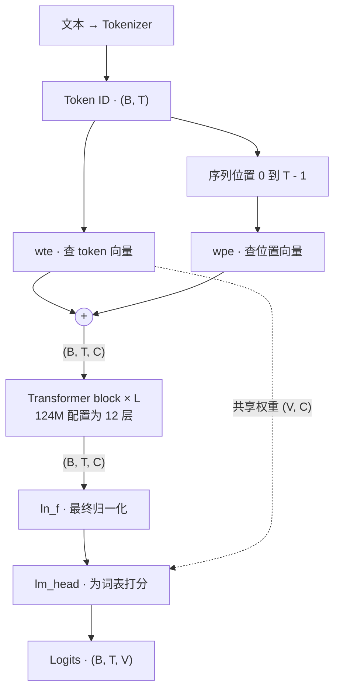
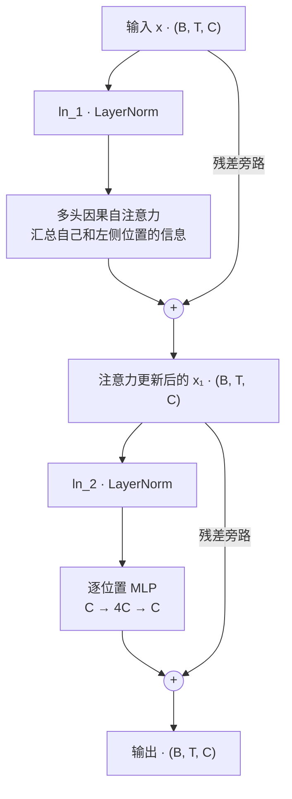

# 阶段 2：GPT-2 模型结构问答

## 导读

[阶段 1 的 tokenizer](01-tokenizer.md#1-tokenizer-的整体结构)把文本变成一串 token ID。模型从这些编号出发，先查表得到向量，再让 Transformer 处理整段序列。

## 0 进度与成果

| 小节 | 产出 | 状态 |
|---|---|---|
| 输入嵌入 | `GPT2Embeddings`，用 `wte` 和 `wpe` 合成每个位置的输入向量 | 已完成 |
| 因果自注意力 | `CausalSelfAttention`，用当前位置及之前的位置计算新的向量 | 已完成 |
| Transformer block | `MLP` 和 `TransformerBlock`，用归一化和残差接起注意力与 MLP | 已完成 |
| 完整模型 | `GPT2`，堆叠 block 并用共享权重输出下一个 token 的分数 | 已完成 |

## 1 模型的输入怎么走到输出

每段文本先由 tokenizer 编码。把多段等长的 ID 序列放进一个张量，形状是 `(B, T)`。输入嵌入把每个编号换成一条浮点向量，形状变成 `(B, T, C)`。多个 Transformer block 逐层更新这些向量。最后用 `ln_f` 做归一化，再用 `lm_head` 为词表里的 `V` 个候选打分，得到 `(B, T, V)`。



实线表示前向计算的输入和输出。虚线表示 `wte` 的 token 表也供 `lm_head` 打分使用。[展开看一个 block](#5-transformer-block)

| 方法 | 什么时候用 | 输入和结果 |
|---|---|---|
| [`GPT2Embeddings.__init__`](#初始化两张查找表) | 创建输入嵌入模块时 | 用词表大小、最大序列长度和向量维度建好两张可训练的表。 |
| [`GPT2Embeddings.forward`](#前向计算怎么查表和相加) | 每次调用输入嵌入模块时 | 把整数 ID `(B, T)` 变成浮点向量 `(B, T, C)`。 |
| [`CausalSelfAttention.__init__`](#初始化注意力的投影层) | 创建注意力模块时 | 用向量维度和头数算出每头宽度，创建两个线性层。 |
| [`CausalSelfAttention.forward`](#前向计算的每一步) | 每次调用注意力模块时 | 把输入向量 `(B, T, C)` 变成融合了可见上下文的向量 `(B, T, C)`。 |
| [`MLP.__init__`](#mlp-逐位置处理特征) | 创建 MLP 时 | 建立升维、激活函数和降维投影。 |
| [`MLP.forward`](#mlp-逐位置处理特征) | 每次调用 MLP 时 | 独立变换每个位置的特征，维度经历 `C → 4C → C`。 |
| [`TransformerBlock.__init__`](#transformerblock-接入自注意力和-mlp) | 创建 block 时 | 把两份归一化、现有自注意力和 MLP 装到一个模块里。 |
| [`TransformerBlock.forward`](#transformerblock-接入自注意力和-mlp) | 每次调用 block 时 | 先加回注意力的结果，再把 MLP 的结果加到更新后的向量上。 |
| [`GPT2.__init__`](#初始化如何装好完整模型) | 创建完整模型时 | 依次装配输入嵌入、多个 block、最终归一化与输出层，设置权重共享和残差初始化。 |
| [`GPT2.forward`](#完整模型如何输出-logits) | 每次调用完整模型时 | 将一批 ID `(B, T)` 变成每个位置的一组词表分数 `(B, T, V)`。 |

读形状时，`(2, 3, 8)` 表示有 2 段序列，每段 3 个位置，每个位置存 8 个数。下面的字母对应这些具体的数量。

| 字母 | 含义 |
|---|---|
| `B` | 批量大小，一次处理多少段序列。 |
| `T` | 当前输入的序列长度，每段有多少个 token。 |
| `V` | 词表大小，有多少个可查的 token ID。 |
| `P` | 位置表的行数，也就是支持的最大序列长度。 |
| `C` | 每个位置的向量里有多少个数。 |
| `H` | 注意力头数。 |
| `D` | 每个头的向量宽度，等于 `C // H`。 |
| `L` | 完整模型堆叠了多少个 Transformer block。 |

这些模块在同一个文件里。`import torch` 提供创建张量和计算权重的操作，`from torch import nn` 提供查表层、线性层、归一化和权重初始化，`import math` 用于计算注意力的缩放因子 `sqrt(D)`。[查看源码](../../gpt2/model.py)

## 2 输入嵌入

### 目标与接口

`GPT2Embeddings(vocab_size, max_seq_len, embedding_dim)` 建立两张表。把输入 ID 张量传给这个对象，就能得到每个位置的输入向量。[gpt2/model.py](../../gpt2/model.py)

| 名称 | 形状 | 含义 |
|---|---|---|
| `input_ids` | `(B, T)` | `B` 段序列，每段有 `T` 个整数 token ID。 |
| `wte.weight` | `(V, C)` | 词表大小 `V` 决定行数，每个 token ID 对应一行。 |
| `wpe.weight` | `(P, C)` | 最大序列长度 `P` 决定行数，位置 `0` 到 `P - 1` 一行一个。 |
| 输出 | `(B, T, C)` | 每个输入位置对应一条由两个向量相加得到的向量。 |

### 初始化两张查找表

```python
class GPT2Embeddings(nn.Module):
    """查出 token 向量和绝对位置向量，并将它们逐项相加。"""

    # 建立两张可训练的查找表。每个 token 一行，每个序列位置也有一行。
    def __init__(
        self, vocab_size: int, max_seq_len: int, embedding_dim: int
    ) -> None:
        """用词表大小 V、最大序列长度 P 和向量维度 C 初始化 embedding。

        wte.weight 的形状是 (V, C)，wpe.weight 的形状是 (P, C)。
        """
        super().__init__()
        self.wte = nn.Embedding(vocab_size, embedding_dim)
        self.wpe = nn.Embedding(max_seq_len, embedding_dim)

        # 沿用原版 GPT-2 的随机初始化，两个表分别使用不同的标准差。
        nn.init.normal_(self.wte.weight, std=0.02)
        nn.init.normal_(self.wpe.weight, std=0.01)
```

1. `class GPT2Embeddings(nn.Module)` 把两张表组织成一个 PyTorch 模块。创建对象时调用 `__init__`。其中 `vocab_size` 决定 token 表有几行，`max_seq_len` 决定位置表有几行，`embedding_dim` 决定两张表各有几列。
2. `super().__init__()` 先初始化父类 `nn.Module`。接下来把两个 `nn.Embedding` 存到 `self` 上，PyTorch 就会登记它们的权重。这样可以通过 `parameters()` 找到训练参数，也可以用 `to(device)` 将它们一起移动到其他设备。
3. `self.wte = nn.Embedding(vocab_size, embedding_dim)` 建出 token 表。`self.wte` 是负责执行查表的模块，`self.wte.weight` 是表里的实际数字。比如 `V = 4`、`C = 3` 时，它有 4 行 3 列，ID `2` 对应从 0 开始数的第 2 行。
4. `self.wpe = nn.Embedding(max_seq_len, embedding_dim)` 建出位置表。取这一行用的是位置编号。例如 `P = 3` 时，可以查位置 `0`、`1` 或 `2`。它也有 `C` 列，所以两张表各查出一行后，可以把第 0 个数对第 0 个数、第 1 个数对第 1 个数，依次相加。
5. `nn.init.normal_(self.wte.weight, std=0.02)` 把 token 表填成围绕 0 分布的随机数。`std` 是标准差，控制这些数大致有多分散。函数名末尾的下划线表示直接改这张权重表的内容。
6. `nn.init.normal_(self.wpe.weight, std=0.01)` 用同样方法初始化位置表，初始分散程度更小。这里的两个标准差取自 GPT-2 原版实现。[GPT-2 官方实现](https://github.com/openai/gpt-2/blob/master/src/model.py)

以 `GPT2Embeddings(vocab_size=4, max_seq_len=3, embedding_dim=3)` 为例，两张表分别有 `4 × 3 = 12` 和 `3 × 3 = 9` 个可训练参数。表的尺寸在创建时确定，实际输入有两个 token 时，位置表只会查到第 0 行和第 1 行。

### 前向计算怎么查表和相加

```python
    # 同一批序列共用位置编号 0 到 T - 1，每个位置把查出的两个向量相加。
    def forward(self, input_ids: torch.Tensor) -> torch.Tensor:
        """输入 (B, T) 的整数 token ID，返回 (B, T, C) 的输入向量。

        B 为批量大小，T 为序列长度，C 为向量维度。
        ID 必须在词表范围内，T 不能超过位置表的行数。
        input_ids 和两张表应在同一设备上。
        """
        if input_ids.ndim != 2:
            raise ValueError("input_ids must have shape (batch_size, sequence_length)")
        sequence_length = input_ids.shape[1]
        if sequence_length > self.wpe.num_embeddings:
            raise ValueError("sequence length exceeds max_seq_len")

        # 新建的位置编号跟随输入设备，模型搬到 MPS 或 CUDA 时也能直接查表。
        position_ids = torch.arange(sequence_length, device=input_ids.device)
        token_embeddings = self.wte(input_ids)  # (B, T, C)
        position_embeddings = self.wpe(position_ids)  # (T, C)

        # (T, C) 沿批量维广播：每段序列的第 t 个 token 都加同一个位置向量。
        return token_embeddings + position_embeddings
```

1. 写 `embeddings(input_ids)` 时，PyTorch 会调用 `forward`。第一个 `if` 检查是否有两维。`[1, 1]` 是一维，表示一串 ID。`[[1, 1]]` 是两维，外层有一段序列，内层有两个位置，形状是 `(1, 2)`。传入一维时，`raise ValueError(...)` 会在查表前指出形状要求。
2. `sequence_length = input_ids.shape[1]` 取第二维的长度，也就是实际序列长度 `T`。这里的 `1` 是轴编号。
3. `if sequence_length > self.wpe.num_embeddings` 比较 `T` 和位置表行数 `P`。例如 `P = 3` 时，`T = 3` 正好用到位置 `0`、`1`、`2`。传入 4 个位置会需要第 3 行，所以函数提前抛出 `ValueError`。
4. `position_ids = torch.arange(sequence_length, device=input_ids.device)` 生成形状为 `(T,)` 的整数位置张量。`T = 2` 时就是 `[0, 1]`。参数 `device` 让新张量直接建在输入所在设备上，例如 MPS。输入、位置 ID 和两张表在同一设备上完成查表。
5. `token_embeddings = self.wte(input_ids)` 逐个读取 token ID，然后为它取出 `wte.weight` 的对应行。输入先有 `B` 段、每段 `T` 个 ID。每个 ID 变成 `C` 个数后，得到 `(B, T, C)`。
6. `position_embeddings = self.wpe(position_ids)` 为 `0` 到 `T - 1` 的每个位置取一行，得到 `(T, C)`。同批所有序列的第 0 个位置都使用 `wpe.weight[0]`，所以这里只需要查一份位置 ID。
7. `return token_embeddings + position_embeddings` 按各维的长度自动对齐。相加时 PyTorch 将 `(T, C)` 视作 `(1, T, C)`，把这一份位置向量用于每段序列。这种自动对齐叫广播。具体到第 `b` 段第 `t` 个位置，就是取 `wte.weight[input_ids[b, t]]` 再加 `wpe.weight[t]`。最终返回 `(B, T, C)`。

#### 手算两段序列的查表结果

下面用单元测试中的固定权重。输入 ID 为 `[[1, 1], [2, 0]]`，即两段序列各有两个 token。每段的第 0 个位置都会加 `[1, 0, 2]`，第 1 个位置都会加 `[0, 3, 1]`。

| 序列 | 位置 | token ID | token 表查到的行 | 位置表查到的行 | 相加结果 |
|---|---|---|---|---|---|
| 0 | 0 | 1 | `[2, 1, 4]` | `[1, 0, 2]` | `[3, 1, 6]` |
| 0 | 1 | 1 | `[2, 1, 4]` | `[0, 3, 1]` | `[2, 4, 5]` |
| 1 | 0 | 2 | `[0, 3, 2]` | `[1, 0, 2]` | `[1, 3, 4]` |
| 1 | 1 | 0 | `[5, 0, 1]` | `[0, 3, 1]` | `[5, 3, 2]` |

按表中顺序把结果放回各自的序列，就得到 `[[[3, 1, 6], [2, 4, 5]], [[1, 3, 4], [5, 3, 2]]]`，形状是 `(2, 2, 3)`。看第一段可知同一个 token 在两个位置的结果如何变化，看两段的第 0 列可知同一个位置向量如何跨序列复用。

### 验收

测试用固定的小表验证两张表的形状、多个序列的逐项相加，以及计算梯度时重复 token 对同一行贡献的累加。形状不对和超过位置表范围的输入也有单独校验。[输入嵌入测试](../../tests/test_gpt2_embeddings.py)

梯度测试使用 `[[1, 1], [2, 1]]`，把输出中所有数字加起来再反向传播。token ID `1` 出现三次，`wte.weight[1]` 的每个数都被加进这个总和三次，因此那一行的梯度是 `[3, 3, 3]`。每段都使用位置 `0`、`1`，两段合起来让这两行的位置表梯度各是 `[2, 2, 2]`。位置 `2` 这一轮没有参与，梯度为 `[0, 0, 0]`。

用本地 GPT-2 tokenizer 把 `" Hello!"` 编成 `[18435, 0]`。包成一段序列后，输入形状是 `(1, 2)`。验收时把向量长度设为 `3`，输出得到 `(1, 2, 3)`，每个位置的值都等于对应的 token 行加位置行。

### 相关问答

#### Q2.1 Token embedding（`wte`）和位置 embedding（`wpe`）是什么？

**A：** 它们是两张查表用的数字表。每一行都是一个向量，也就是一串数字。`wte` 用 token ID 查行，告诉模型当前是什么 token。`wpe` 用序列位置查行，给这次出现加上位置信息。

假设 tokenizer 输出 `[18435, 18435]`，表示同一个 token 连续出现两次。这个手算例子里，每行只有三个数字。

| 出现位置 | 查 `wte` 得到的 token 向量 | 查 `wpe` 得到的位置向量 | 两个向量逐项相加 |
|---|---|---|---|
| 0 | `wte[18435] = [2, 1, 4]` | `wpe[0] = [1, 0, 2]` | `[3, 1, 6]` |
| 1 | `wte[18435] = [2, 1, 4]` | `wpe[1] = [0, 3, 1]` | `[2, 4, 5]` |

两次出现都查 `wte` 的同一行，位置却分别查 `wpe` 的第 0 行和第 1 行。相加后得到两个带位置信息的输入向量，然后交给 Transformer。表里的数字是模型参数，训练时会根据预测下一个 token 的误差更新。

#### Q2.2 不同模型的 token embedding 和位置 embedding 一样吗？

**A：** 把 token 变成向量是常见做法，但每个模型的词表、向量长度和参数都可能不同。比如两个模型收到同一个 ID `18435`，要先分别查它们的词表，才能知道这个 ID 各自代表什么。即使两者用同一套词表，同一个 token 查到的向量也可能不同，因为表里的数字可以在训练中学成不同的值。

模型利用位置的方式也会变。GPT-2 在输入端用位置查 `wpe`，再把查到的向量加到 token 向量上。LLaMA 用 RoPE（旋转位置编码），在注意力计算时根据位置旋转用于比较的向量，让这一步带上位置信息。[GPT-2 官方实现](https://github.com/openai/gpt-2/blob/master/src/model.py) · [LLaMA 官方实现](https://github.com/meta-llama/llama/blob/main/llama/model.py)

## 3 因果自注意力

### 概念

[输入嵌入](#2-输入嵌入)给每个位置一条向量，里面有 token 本身和它的位置。自注意力再为每个位置更新这条向量。它计算序列中哪些位置值得参考，并按算出的权重把各位置的信息加起来。这里的「自」指拿来互相比较的向量都来自同一条输入序列。

假设 `猫`、`吃`、`鱼` 已经切成三个 token。下面每一行表示正在更新的位置，每一列表示可以从哪个位置取信息。

| 正在更新的位置 | 位置 0「猫」 | 位置 1「吃」 | 位置 2「鱼」 |
|---|---|---|---|
| 0「猫」 | 可读取 | 遮住 | 遮住 |
| 1「吃」 | 可读取 | 可读取 | 遮住 |
| 2「鱼」 | 可读取 | 可读取 | 可读取 |

更新「吃」的向量时，可以结合「猫」和「吃」。完整模型稍后用这个位置的向量预测下一个 token「鱼」，所以此时必须遮住「鱼」所在的位置。「因果」就是这个约束，即每个位置只使用自身及左边的输入。即使训练时整段序列一起送进模型，遮罩也会把这个约束应用到每一行。

### 目标与接口

`CausalSelfAttention(embedding_dim, num_heads)` 接收 `(B, T, C)` 的浮点向量。它为每个位置计算一个新的 `C` 维向量，所以结果仍是 `(B, T, C)`。例如「吃」的位置可以用一部分来自「猫」的向量和一部分来自「吃」的向量，得到结合上下文的新表示。

| 中间量 | 用途 |
|---|---|
| Q，query（查询向量） | 表示当前这个位置要找什么信息。 |
| K，key（键向量） | 供其他位置的 Q 与它比较，算出匹配分数。 |
| V，value（值向量） | 某个位置被参考时，实际取走的向量。 |
| `weights` | 每行是一处分数归一化后的权重，决定当前位置从每个 V 取多少。 |

每个注意力头各有自己的 Q、K、V 和权重。最后把所有头的加权结果拼起来，作为输出投影的输入。

### 初始化注意力的投影层

代码位于 [gpt2/model.py](../../gpt2/model.py)。

```python
class CausalSelfAttention(nn.Module):
    """按各头的注意力权重汇总当前位置和之前位置的信息。"""

    # 设置头数和每头的宽度，建立 Q/K/V 共用的投影层和输出投影层。
    def __init__(self, embedding_dim: int, num_heads: int) -> None:
        """用向量维度 C 和头数 H 创建注意力，要求 C 可被 H 整除。

        每头处理 D = C // H 个数。两个线性层的权重形状为 (3C, C) 和 (C, C)。
        """
        super().__init__()
        if embedding_dim <= 0 or num_heads <= 0 or embedding_dim % num_heads != 0:
            raise ValueError("embedding_dim must be a positive multiple of num_heads")

        self.num_heads = num_heads
        self.head_dim = embedding_dim // num_heads
        self.c_attn = nn.Linear(embedding_dim, 3 * embedding_dim)
        self.c_proj = nn.Linear(embedding_dim, embedding_dim)

        # 沿用原版 GPT-2 的线性层初始化，权重标准差为 0.02，偏置为 0。
        nn.init.normal_(self.c_attn.weight, std=0.02)
        nn.init.zeros_(self.c_attn.bias)
        nn.init.normal_(self.c_proj.weight, std=0.02)
        nn.init.zeros_(self.c_proj.bias)
```

1. `class CausalSelfAttention(nn.Module)` 定义注意力模块。`__init__` 接收向量维度 `C = embedding_dim` 和头数 `H = num_heads`，`super().__init__()` 先初始化父类，以便后面登记两个线性层。
2. `if embedding_dim <= 0 or num_heads <= 0 or embedding_dim % num_heads != 0` 检查两者都为正数，并且 `C` 除以 `H` 没有余数。头数为 0 时，第二个条件已成立，Python 跳到报错分支，避免执行对 0 取余。
3. `self.num_heads = num_heads` 保存头数，供 `forward` 拆头时使用。
4. `self.head_dim = embedding_dim // num_heads` 算出每头宽度 `D`。例如 `C = 8`、`H = 2`，每个头就有 4 个数。
5. `self.c_attn = nn.Linear(embedding_dim, 3 * embedding_dim)` 把每个位置的 `C` 个数变成 `3C` 个。线性层每算一个输出数，都把输入向量和该输出对应的一组权重逐项相乘再求和，最后加一个偏置。这里同一层的输出依次划为 Q、K、V，每组 `C` 个数，各组使用各自对应的权重行。整个层的权重形状是 `(3C, C)`，偏置是 `(3C,)`。
6. `self.c_proj = nn.Linear(embedding_dim, embedding_dim)` 建立输出投影。它等所有头的结果拼成 `C` 个数后，在每个位置用线性层重新组合这些数，得到另一个 `C` 维向量。权重形状是 `(C, C)`，偏置是 `(C,)`。
7. 后面四行依次初始化 `c_attn.weight`、`c_attn.bias`、`c_proj.weight`、`c_proj.bias`。两行 `nn.init.normal_` 从均值 0、标准差 `0.02` 的正态分布填入权重。两行 `nn.init.zeros_` 令两个层的偏置从 0 开始。这是原版公开模型代码中投影层的基础初始化。[GPT-2 官方实现](https://github.com/openai/gpt-2/blob/master/src/model.py)

例如 `C = 8` 时，`c_attn` 有 `24 × 8 + 24 = 216` 个参数，`c_proj` 有 `8 × 8 + 8 = 72` 个。头数决定中间结果按多宽拆分，两个线性层的尺寸由 `C` 决定。

### 前向计算的每一步

```python
    # 对每个头计算注意力分数、遮住未来位置，再汇总 V 并拼回各头。
    def forward(self, x: torch.Tensor) -> torch.Tensor:
        """接收 (B, T, C) 的浮点输入并返回 (B, T, C) 的注意力结果。

        B 是批量大小，T 是序列长度，C 是向量维度。
        H 是注意力头数，D 是每头的向量维度。
        每个位置的结果只依赖该位置及其之前的输入。
        """
        if x.ndim != 3 or x.shape[-1] != self.c_attn.in_features:
            raise ValueError("x must have shape (batch_size, sequence_length, embedding_dim)")
        batch_size, sequence_length, embedding_dim = x.shape

        qkv = self.c_attn(x)  # (B, T, 3C)
        qkv = qkv.reshape(
            batch_size, sequence_length, 3, self.num_heads, self.head_dim
        )  # (B, T, 3, H, D)
        # 把 Q/K/V 放到最前面，取出三个形状为 (B, H, T, D) 的张量。
        qkv = qkv.permute(2, 0, 3, 1, 4)  # (3, B, H, T, D)
        query, key, value = qkv.unbind(dim=0)

        # 每行是一处查询位置，每列是可供比较的一个键位置。
        transposed_key = key.transpose(-2, -1)  # (B, H, D, T)
        scores = (query @ transposed_key) / math.sqrt(self.head_dim)  # (B, H, T, T)

        positions = torch.arange(sequence_length, device=x.device)  # (T,)
        future_mask = positions.unsqueeze(0) > positions.unsqueeze(1)  # (T, T)
        # 遮罩对所有序列和注意力头生效，未来位置经过 softmax 后的权重为零。
        scores = scores.masked_fill(future_mask, float("-inf"))  # (B, H, T, T)
        weights = torch.softmax(scores, dim=-1)  # (B, H, T, T)

        context = weights @ value  # (B, H, T, D)
        context = context.transpose(1, 2)  # (B, T, H, D)
        context = context.reshape(batch_size, sequence_length, embedding_dim)  # (B, T, C)
        return self.c_proj(context)  # (B, T, C)
```

#### 检查输入，拆出 Q、K、V

1. `if x.ndim != 3 or x.shape[-1] != self.c_attn.in_features` 检查输入是三维，并且最后一维等于创建模块时传入的 `embedding_dim`。任一条件不满足，`raise ValueError(...)` 会在矩阵乘法之前指出输入形状要求。
2. `batch_size, sequence_length, embedding_dim = x.shape` 取出 `B`、`T`、`C`。后面的换形状、生成位置编号以及拼头都用这三个数。
3. `qkv = self.c_attn(x)` 对每段序列的每个位置单独执行同一个线性层，得到 `(B, T, 3C)`。例如 `C = 4`，单个位置的 12 个输出依次是 4 个 Q、4 个 K、4 个 V。
4. `qkv.reshape(batch_size, sequence_length, 3, self.num_heads, self.head_dim)` 将最后一维的 `3C` 拆成 `3 × H × D`。对 `C = 4`、`H = 2` 的例子，假设那 12 个输出依次是 `1` 到 `12`，那么 Q 的两个头分别拿 `[1, 2]`、`[3, 4]`，K 的两个头拿 `[5, 6]`、`[7, 8]`，V 的两个头拿 `[9, 10]`、`[11, 12]`。
5. `qkv.permute(2, 0, 3, 1, 4)` 按原来的轴编号重新排序。原轴 0 是 `B`、轴 1 是 `T`、轴 2 是 Q/K/V 类别、轴 3 是 `H`、轴 4 是 `D`，所以排序后是 `(3, B, H, T, D)`，每个头的一整段序列都位于最后两维。
6. `query, key, value = qkv.unbind(dim=0)` 沿最前面这根长度为 3 的轴取出三份张量。被取的那根轴随之去掉，每份形状都是 `(B, H, T, D)`。

#### 算分、遮住未来并得到权重

1. `transposed_key = key.transpose(-2, -1)` 交换 K 的最后两根轴，形状从 `(B, H, T, D)` 变为 `(B, H, D, T)`。可以把它看成每列放一个位置的 K，便于拿 Q 的某一行和它做点积。
2. `query @ transposed_key` 对每段序列、每个头分别做 `(T, D) @ (D, T)`。输出的一个分数就是位置 `i` 的 Q 与位置 `j` 的 K 对应数字相乘再求和。例如 `[0, 2]` 和 `[1, 0.5]` 的点积是 `0 × 1 + 2 × 0.5 = 1`。再除以 `math.sqrt(self.head_dim)`，控制头变宽时点积的典型大小，避免 softmax 权重过早集中到少数位置。分数整体形状为 `(B, H, T, T)`。
3. `positions = torch.arange(sequence_length, device=x.device)` 得到 `[0, 1, ..., T - 1]`。设备跟随输入，遮罩接下来可以直接用在分数上。
4. `positions.unsqueeze(0)` 把位置排成 `(1, T)` 的一行，作为列坐标 `j`。`positions.unsqueeze(1)` 把它排成 `(T, 1)` 的一列，作为行坐标 `i`。比较 `j > i` 后，广播得到一张 `(T, T)` 的布尔遮罩。比如 `future_mask[1, 2]` 为真，因为位置 2 对位置 1 来说在未来。`future_mask[2, 1]` 为假，因为位置 2 可以参考位置 1。
5. `scores.masked_fill(future_mask, float("-inf"))` 把每一个为真的单元替换成负无穷。所有序列和头都应用同一张 `(T, T)` 遮罩，结果仍是 `(B, H, T, T)`。对角线对应的是同一个序列位置，`j == i` 时比较结果为假，所以它始终保留。
6. `weights = torch.softmax(scores, dim=-1)` 沿最后一维，也就是一行的全部键位置，分配总和为 1 的权重。计算时每个分数的指数除以同行指数之和，负无穷变成 0。例如原来一行是 `[0, ln(3), 9]`，如果最后一项在未来，遮罩后就是 `[0, ln(3), -inf]`，对应指数 `[1, 3, 0]`，权重为 `[0.25, 0.75, 0]`。

#### 加权汇总，再把各头拼回去

1. `context = weights @ value` 对每段序列和每个头做 `(T, T) @ (T, D)`。左边的一行提供各个来源位置的权重，右边的每一行是一个来源位置的 V。比如权重 `[0.25, 0.75, 0]` 乘上 V，前两个位置分别贡献 `0.25 × [4, 0]` 和 `0.75 × [0, 8]`，加起来是 `[1, 6]`。整体形状为 `(B, H, T, D)`。
2. `context.transpose(1, 2)` 交换头轴和位置轴，变成 `(B, T, H, D)`。现在可以先选某个位置，再依次取出它的各个头。
3. `context.reshape(batch_size, sequence_length, embedding_dim)` 合并最后的 `H` 和 `D`，得到 `(B, T, C)`。比如一个位置的两个头输出 `[1, 6]`、`[2, 3]`，拼接后是 `[1, 6, 2, 3]`。
4. `return self.c_proj(context)` 把拼好的每个向量送进输出线性层。它在每个位置重新组合来自各头的数字，保持向量长度 `C`，也就保持整个结果的形状 `(B, T, C)`。

#### 用具体数字检查全部中间形状

取 `B = 2`、`T = 3`、`C = 8`、`H = 2`，则 `D = 4`。这里把 `T` 和 `D` 取成不同的数字，方便看出哪一步交换了它们。

| 代码中的中间量 | 通用形状 | 代入后的形状 |
|---|---|---|
| 输入 `x` | `(B, T, C)` | `(2, 3, 8)` |
| `c_attn(x)` | `(B, T, 3C)` | `(2, 3, 24)` |
| 第一次 `reshape` | `(B, T, 3, H, D)` | `(2, 3, 3, 2, 4)` |
| `permute` | `(3, B, H, T, D)` | `(3, 2, 2, 3, 4)` |
| `query`、`key`、`value` 各自 | `(B, H, T, D)` | `(2, 2, 3, 4)` |
| `transposed_key` | `(B, H, D, T)` | `(2, 2, 4, 3)` |
| `positions` | `(T,)` | `(3,)` |
| `future_mask` | `(T, T)` | `(3, 3)` |
| `scores`、遮罩后的 `scores`、`weights` | `(B, H, T, T)` | `(2, 2, 3, 3)` |
| `weights @ value` | `(B, H, T, D)` | `(2, 2, 3, 4)` |
| `context.transpose(1, 2)` | `(B, T, H, D)` | `(2, 3, 2, 4)` |
| 拼好各头后的 `context` 和最终输出 | `(B, T, C)` | `(2, 3, 8)` |

分数张量里每个头有 `T × T` 个数，因为每个查询位置都要和每个键位置比较。当前实现会先算出整张分数矩阵，再遮住未来位置。序列长度翻倍时，这张矩阵的元素数量变成四倍。

#### 手算一次两头注意力

单元测试把输入和线性层权重固定下来。输入只有一段序列、两个位置，`C = 4`、`H = 2`，所以每个头处理两个数。Q 投影保留输入，K 投影把第二个数替换为输入前两个数的平均值，V 投影把四个数分别乘以 `[1, 3, 2, 1]`。偏置都设为零。符号 `｜` 用来显示两个头的分界。

| 位置 | 输入 | Q | K | V |
|---|---|---|---|---|
| 0 | `[1, 0, 0, 1]` | `[1, 0 ｜ 0, 1]` | `[1, 0.5 ｜ 0, 1]` | `[1, 0 ｜ 0, 1]` |
| 1 | `[0, 2, 2, 1]` | `[0, 2 ｜ 2, 1]` | `[0, 1 ｜ 2, 1]` | `[0, 6 ｜ 4, 1]` |

位置 0 的未来位置被遮住，每个头的权重都是 `[1, 0]`，所以两个头的输出就是位置 0 自己的 V。到了位置 1，两个位置都可以参与，两个头的计算如下。

| 位置 1 的计算 | 头 0 | 头 1 |
|---|---|---|
| 当前 Q | `[0, 2]` | `[2, 1]` |
| 与位置 0 的 K 做点积 | `0 × 1 + 2 × 0.5 = 1` | `2 × 0 + 1 × 1 = 1` |
| 与位置 1 的 K 做点积 | `0 × 0 + 2 × 1 = 2` | `2 × 2 + 1 × 1 = 5` |
| 将两个分数都除以 `sqrt(2)` 后做 softmax | `[1 - p, p]`，其中 `p ≈ 0.669762` | `[1 - r, r]`，其中 `r ≈ 0.944193` |
| 对所选 V 加权求和 | `(1 - p) × [1, 0] + p × [0, 6] = [1 - p, 6p]` | `(1 - r) × [0, 1] + r × [4, 1] = [4r, 1]` |

这里的 `p` 和 `r` 都是各自的头分配给位置 1 的权重。举例，`p` 来自 `exp(2 / sqrt(2)) / (exp(1 / sqrt(2)) + exp(2 / sqrt(2)))`。测试最后把 `c_proj` 的权重设成单位矩阵的两倍，因此拼头后每个数再乘 2。位置 0 的最终向量是 `[2, 0, 0, 2]`。位置 1 是 `[2 × (1 - p), 12p, 8r, 2]`，约等于 `[0.660477, 8.037138, 7.553542, 2]`。[固定投影的单元测试](../../tests/test_gpt2_attention.py)

### 验收

- **形状**。例如输入形状为 `(2, 4, 8)`、头数为 2 时，每个头的分数矩阵是 `4 × 4`，最终输出仍是 `(2, 4, 8)`。
- **因果性**。用前缀完全相同的两段输入做对照。只修改第 2 个位置之后的输入，前两个位置的注意力输出应保持一致。
- **加权结果**。用小张量固定 Q、K、V，手算某个位置的加权和，再核对模块输出。

5 项专项测试覆盖形状、因果性、两头各自的缩放和加权结果、反向传播以及非法输入。用逐位置计算的独立参考实现也对上了输出和梯度。CPU 与 MPS 的前向、因果性和梯度核对通过。[自注意力测试](../../tests/test_gpt2_attention.py)

这一小节的输出是新的序列向量。在后续 Transformer block 小节中，注意力会与归一化、残差和 MLP 接起来。

### 相关问答

#### Q3.1 残差分支的输出投影现在需要缩放初始化吗？

**A：** 当前注意力模块沿用公开的 GPT-2 `src/model.py`，权重以标准差 `0.02` 初始化。建议组装完整模型时统一处理深度缩放，那时已知道一共堆叠了多少个 Transformer block。残差加法会把分支计算结果加回原向量。层数增多时，沿途会反复累加，所以论文提出按残差分支数 `N`，用 `1 / sqrt(N)` 缩放这些分支输出权重的初始值。[GPT-2 论文 §2.3](https://cdn.openai.com/better-language-models/language_models_are_unsupervised_multitask_learners.pdf#page=4) · [GPT-2 公开模型代码](https://github.com/openai/gpt-2/blob/master/src/model.py)

设完整模型有 `L` 个 block。每个 block 的注意力和 MLP 各有一次残差加法，所以 nanoGPT 按 `N = 2L` 处理。组装时可统一把 `attn.c_proj.weight` 和 `mlp.c_proj.weight` 的初始化标准差设成 `0.02 / sqrt(2 * L)`。例如 `L = 12` 时约为 `0.00408`。这个系数用于随机初始化，阶段 3 加载的官方权重会覆盖相应的初始值。[nanoGPT 初始化代码](https://github.com/karpathy/nanoGPT/blob/master/model.py#L128-L134)

#### Q3.2 这一节现在需要加入 dropout 吗？

**A：** 目前用确定性的注意力计算验收手算值和因果性，阶段 3 也便于对齐官方权重。阶段 5 可以从 `dropout=0` 的基线开始训练。如果训练损失继续下降、验证损失开始回升，再考虑加入默认值为 `0` 的可选参数，比较同样设置下的验证结果。Dropout 在训练时随机屏蔽部分值，用于减少过拟合。评估和推理用 `eval()` 模式。nanoGPT 的默认配置是 `0`，它的字符级 Shakespeare 训练示例用 `0.2`。[nanoGPT 默认配置](https://github.com/karpathy/nanoGPT/blob/master/model.py#L99-L107) · [字符级训练配置](https://github.com/karpathy/nanoGPT/blob/master/config/train_shakespeare_char.py#L14-L22)

## 4 把输入嵌入和注意力接起来

从仓库根目录运行这个例子。词表文件沿用阶段 1 中的 `data/gpt2/`。[GPT-2 词表准备](01-tokenizer.md#7-接上-gpt-2-官方词表和合并规则)

```python
import torch

from gpt2.model import CausalSelfAttention, GPT2Embeddings
from gpt2.tokenizer import GPT2Tokenizer

tokenizer = GPT2Tokenizer("data/gpt2/encoder.json", "data/gpt2/vocab.bpe")
ids = tokenizer.encode(" Hello!")
assert ids == [18435, 0]

input_ids = torch.tensor([ids], dtype=torch.long)  # (1, 2)
embeddings = GPT2Embeddings(len(tokenizer.encoder), max_seq_len=8, embedding_dim=8)
attention = CausalSelfAttention(embedding_dim=8, num_heads=2)

x = embeddings(input_ids)  # (1, 2, 8)
output = attention(x)  # (1, 2, 8)
assert x.shape == output.shape == (1, 2, 8)
```

这段文本得到两个 token ID。外面包一层列表，表示一起处理的只有一段序列。位置表最多有 8 行，这次只查位置 `0` 和 `1`。输入嵌入为每个位置生成 8 个数，注意力用 2 个各宽 4 的头计算，最后再拼回 8 个数。第一个位置只参考自己，第二个位置可以参考两个位置。这个例子使用随机初始化的权重，运行时重点核对编号、形状和两块代码能否接起来。

完整的 GPT-2 block 会先对输入做归一化，再执行注意力。注意力的结果沿残差路径加回，接着进入归一化和 MLP。这些步骤会在下一小节接上。

## 5 Transformer block

### 一个 block 做什么

一个 block 把序列里的表示再更新一轮。先用[因果自注意力](#3-因果自注意力)从可见的位置汇总信息，再用 MLP 加工每个位置已经汇总好的向量。输入和输出都是 `(B, T, C)`，因此一个 block 的输出可以直接交给下一个 block。



第一个 `+` 把注意力输出加回 `x`，得到 `x₁`。接着 `x₁` 一路进 MLP 分支，另一路直接进第二个 `+`。两次相加各自保留进入该分支前的向量。

| 部件 | 在 block 中的作用 |
|---|---|
| LayerNorm | 对每个位置自己的 `C` 个数做归一化，再用学到的缩放和偏移调整它们。例如同一个位置的向量是 `[1, 3]`，刚初始化时归一化结果约为 `[-1, 1]`。其他位置各算各的。 |
| 因果自注意力 | 让当前位置按权重参考自己和之前的位置，得到一份结合上下文的向量。 |
| MLP | 对每个位置的向量做两次线性变换，中间用 GELU 做非线性处理。同一套 MLP 权重应用到所有位置。 |
| 残差加法 | 将分支算出的向量逐项加回它的输入。例如原向量是 `[2, 3]`，分支输出是 `[1, -1]`，相加后就是 `[3, 2]`。 |

### MLP 逐位置处理特征

调用 `MLP(embedding_dim)` 后，给它一组形状为 `(B, T, C)` 的向量。它对每个位置用同样的方式处理，先把每个位置的特征扩到 `4C`，再变回 `C`。[模型源码](../../gpt2/model.py)

```python
class MLP(nn.Module):
    """在每个位置独立处理特征，先扩到 4C 再投影回 C。"""

    # 建立升维线性层、GELU 激活和输出投影，同一套参数用于所有位置。
    def __init__(self, embedding_dim: int) -> None:
        """用向量维度 C 创建 MLP，两个线性层的权重是 (4C, C) 和 (C, 4C)。"""
        super().__init__()
        hidden_dim = 4 * embedding_dim
        self.c_fc = nn.Linear(embedding_dim, hidden_dim)
        self.gelu = nn.GELU(approximate="tanh")
        self.c_proj = nn.Linear(hidden_dim, embedding_dim)

        # 两个线性层沿用原版 GPT-2 的基础初始化。
        nn.init.normal_(self.c_fc.weight, std=0.02)
        nn.init.zeros_(self.c_fc.bias)
        nn.init.normal_(self.c_proj.weight, std=0.02)
        nn.init.zeros_(self.c_proj.bias)

    # 仅沿每个位置的特征维变换，保持批量大小和序列长度。
    def forward(self, x: torch.Tensor) -> torch.Tensor:
        """把 (B, T, C) 的输入经过 (B, T, 4C) 的中间层变回 (B, T, C)。"""
        expanded = self.c_fc(x)  # (B, T, 4C)
        activated = self.gelu(expanded)  # (B, T, 4C)
        return self.c_proj(activated)  # (B, T, C)
```

#### MLP 的初始化逐行看

1. `class MLP(nn.Module)` 将 MLP 声明成可复用的 PyTorch 模块。`__init__` 收到 `embedding_dim`，也就是每个位置的输入向量长度 `C`。
2. `super().__init__()` 初始化父类。之后存到 `self` 的两个线性层会登记为子模块，模型移动设备、保存权重、训练时都能找到它们。
3. `hidden_dim = 4 * embedding_dim` 算出中间向量需要多少个数。比如 `C = 8`，中间长度就是 32。这里乘 4 的是特征宽度，批量大小和 token 数照旧。
4. `self.c_fc = nn.Linear(embedding_dim, hidden_dim)` 创建第一个线性层。它对每个位置的 `C` 个数做加权组合，生成 `4C` 个新的数。每个输出数都有一行权重和一个偏置，所以 `weight` 的形状为 `(4C, C)`，`bias` 是 `(4C,)`。
5. `self.gelu = nn.GELU(approximate="tanh")` 创建 GELU 激活。它逐个处理升维后的数字。比如输入 `-1` 和 `1`，经过激活后约为 `-0.159` 和 `0.841`。这一步使两次线性组合之间有非线性变换，两层合起来可以表达更复杂的关系。`approximate="tanh"` 选择 GPT-2 公开实现使用的公式。[GPT-2 官方 GELU 实现](https://github.com/openai/gpt-2/blob/master/src/model.py)
6. `self.c_proj = nn.Linear(hidden_dim, embedding_dim)` 创建第二个线性层，从 `4C` 个激活后的数重新组合出 `C` 个数。这样分支结果可以与 block 的输入逐项相加。它的权重形状为 `(C, 4C)`，偏置是 `(C,)`。
7. 后面四行依次填充 `c_fc.weight`、清零 `c_fc.bias`、填充 `c_proj.weight`、清零 `c_proj.bias`。`normal_` 使用均值 0、标准差 `0.02` 的随机初始值，`zeros_` 使偏置从 0 开始。完整模型的残差输出缩放见[初始化问答](#q31-残差分支的输出投影现在需要缩放初始化吗)。

#### MLP 的前向计算逐行看

1. `expanded = self.c_fc(x)` 将每个位置的输入向量从 `C` 维扩到 `4C`，结果形状为 `(B, T, 4C)`。例如 `(2, 4, 8)` 输入变为 `(2, 4, 32)`。
2. `activated = self.gelu(expanded)` 将刚得到的每个数单独送入 GELU，结果仍是 `(B, T, 4C)`。对一段序列中的某个位置，这一步只用该位置自己的数。
3. `return self.c_proj(activated)` 把每个位置的 `4C` 个数投影回 `C` 个，返回 `(B, T, C)`。例子里从 `(2, 4, 32)` 回到 `(2, 4, 8)`。

### TransformerBlock 接入自注意力和 MLP

`TransformerBlock(embedding_dim, num_heads)` 接收 `(B, T, C)`，按 GPT-2 的顺序执行两条分支。两条分支都先做 LayerNorm，这就是 Pre-LayerNorm。[GPT-2 官方 block 实现](https://github.com/openai/gpt-2/blob/master/src/model.py)

```python
class TransformerBlock(nn.Module):
    """按 GPT-2 的 Pre-LayerNorm 顺序执行注意力和 MLP 两次残差更新。"""

    # 给注意力和 MLP 各配一份独立的 LayerNorm，复用已实现的因果自注意力。
    def __init__(self, embedding_dim: int, num_heads: int) -> None:
        """用向量维度 C 和头数 H 创建一个 block，每个子模块都接收 C 维向量。"""
        super().__init__()
        self.ln_1 = nn.LayerNorm(embedding_dim, eps=1e-5)
        self.attn = CausalSelfAttention(embedding_dim, num_heads)
        self.ln_2 = nn.LayerNorm(embedding_dim, eps=1e-5)
        self.mlp = MLP(embedding_dim)

    # 两条分支都先归一化，分支的结果再加回进入这一段计算时的 x。
    def forward(self, x: torch.Tensor) -> torch.Tensor:
        """接收 (B, T, C) 的输入，依次执行注意力和 MLP，返回 (B, T, C)。"""
        attention_input = self.ln_1(x)  # (B, T, C)
        attention_output = self.attn(attention_input)  # (B, T, C)
        x = x + attention_output  # (B, T, C)

        # 第二次归一化使用已经加过注意力结果的 x。
        mlp_input = self.ln_2(x)  # (B, T, C)
        mlp_output = self.mlp(mlp_input)  # (B, T, C)
        return x + mlp_output  # (B, T, C)
```

#### Block 的初始化逐行看

1. `class TransformerBlock(nn.Module)` 让一个 block 成为可反复使用的模块。保存模型时，下面装进去的四个子模块都属于它。`super().__init__()` 先初始化这些登记机制。
2. `self.ln_1 = nn.LayerNorm(embedding_dim, eps=1e-5)` 为注意力建归一化层。它在每个位置的 `C` 个特征上计算均值和方差，再进行可训练的缩放、偏移。`eps` 加在方差上后再开平方，向量里的值全部相同时也能进行除法。参数各有 `C` 个，输出形状保持 `(B, T, C)`。
3. `self.attn = CausalSelfAttention(embedding_dim, num_heads)` 将[已有的因果自注意力](#3-因果自注意力)登记为子模块。它接收归一化后的向量，在内部完成 Q/K/V、拆头、遮罩、加权求和和拼头，返回同样的 `(B, T, C)` 形状。
4. `self.ln_2 = nn.LayerNorm(embedding_dim, eps=1e-5)` 为 MLP 建另一份归一化层。它有自己的缩放和偏移参数，处理的是已经经过第一次残差更新的向量。
5. `self.mlp = MLP(embedding_dim)` 把上面实现的 MLP 登记为第二条分支。它收到 `C` 维向量，在内部扩成 `4C` 处理，再将结果压回 `C`。

#### Block 的前向计算逐行看

1. `attention_input = self.ln_1(x)` 归一化 block 刚收到的输入，得到 `(B, T, C)`。此时原来的 `x` 还在，稍后用来做残差加法。
2. `attention_output = self.attn(attention_input)` 将归一化后的结果交给现有注意力模块。每个位置参考自己和之前的位置，返回一份新的 `(B, T, C)` 向量。
3. `x = x + attention_output` 让原输入和分支输出逐项相加。右侧的 `x` 是本次 block 的原输入，左侧的 `x` 之后指向相加结果。形状相同，因此每个位置、每个特征都加到对应项上。
4. `mlp_input = self.ln_2(x)` 读取上一步更新过的 `x`，再做逐位置归一化。这时的向量已经融合了注意力带来的信息，形状仍是 `(B, T, C)`。
5. `mlp_output = self.mlp(mlp_input)` 分别加工每个位置的特征。虽然内部有一层宽 `4C` 的向量，送回 block 的结果还是 `(B, T, C)`。
6. `return x + mlp_output` 把 MLP 的结果加回刚更新过的 `x`，完成第二次残差加法，返回 `(B, T, C)`。

用一个位置上的两个数字看残差。假设输入是 `[2, 3]`，注意力分支给出 `[1, -1]`，第一步就把它更新成 `[3, 2]`。第二次归一化读到的是 `[3, 2]`。若接下来的 MLP 分支给出 `[0.5, 2]`，最终得到 `[3.5, 4]`。这里的分支输出是手算示意值，用来观察每次加的是哪份 `x`。

### 验收

- **尺寸和 GELU**。用 `(2, 4, 8)` 验证 MLP 和 block 的输出形状。另用固定的 MLP 权重手算中间的 tanh GELU 和输出。
- **两条分支的接法**。给两次 LayerNorm 设定不同的参数，用恒等分支直接观察归一化结果，核对第二次归一化读到的是第一次残差更新后的向量。把真实的注意力和 MLP 的输出权重及偏置清零时，整个 block 返回原输入。
- **因果性**。只修改后两个位置的一项特征，前两个位置的输出应保持一致。测试采用单特征扰动，让变化能通过该位置自己的 LayerNorm。
- **梯度**。从输出反向传播，输入以及注意力、归一化和 MLP 的参数都能收到梯度。

以上 6 项测试通过，前向和梯度与独立参考实现一致。CPU 与 MPS 的前向、因果性和梯度也已对照。[MLP 与 Transformer block 测试](../../tests/test_gpt2_block.py)

接着[第 4 节的例子](#4-把输入嵌入和注意力接起来)，把输入嵌入得到的 `x` 传给完整 block。

```python
from gpt2.model import TransformerBlock

block = TransformerBlock(embedding_dim=8, num_heads=2)
block_output = block(x)
assert block_output.shape == x.shape == (1, 2, 8)
```

### 相关问答

#### Q5.1 写 GPT-2 和一般用 PyTorch 写模型有什么区别？

**A：** 写法跟普通 PyTorch 模型一样。`__init__` 建层，`forward` 规定输入经过哪些层、按什么顺序计算。线性层、归一化、矩阵乘法和反向传播都由 PyTorch 提供。GPT-2 的架构是我们在这些操作之上定义的数据流。

例如 `Linear → GELU → Linear` 是常见的 MLP。在这个项目里，把它用在 `(B, T, C)` 的张量上时，每个位置只用自己的 `C` 个数来计算。位置 0 的向量变了，单独运行 MLP 时位置 1 的输出不会跟着变。把现有的 `CausalSelfAttention` 接进 block 后，位置 1 就能参考位置 0。注意力里的因果遮罩规定它只能参考自己和更早的位置。

这个项目手写的部分是 Q/K/V 怎么拆头、怎么打分和遮住未来，以及在 block 里怎么按「先归一化、算分支、再加回输入」的顺序接起注意力和 MLP。OpenAI 发布的原版用 TensorFlow 表达同样的计算顺序，本项目用 PyTorch 实现。[本项目的模型代码](../../gpt2/model.py) · [GPT-2 官方实现](https://github.com/openai/gpt-2/blob/master/src/model.py)

#### Q5.2 OpenAI 官方的 GPT 模型用 PyTorch 吗？

**A：** 本项目用 PyTorch 重写 GPT-2，OpenAI 当年发布的 GPT-2 模型代码用的是 TensorFlow。两套框架可以实现同样的层和计算顺序。阶段 3 会在本项目里加载同一套官方参数，给两边相同的 token ID，再对比每个位置的输出分数。[本项目模型](../../gpt2/model.py) · [GPT-2 官方实现](https://github.com/openai/gpt-2/blob/master/src/model.py)

OpenAI 在 2020 年宣布以 PyTorch 为主要深度学习框架。一个公开确认的例子是 `gpt-oss-120b` 和 `gpt-oss-20b`，它们的模型卡写明预训练使用 PyTorch，部分 GPU 计算由优化过的 Triton 内核执行。OpenAI 也为这两个模型发布了 PyTorch 和 Apple Metal 的推理参考实现。训练和部署可以使用不同的工具。[OpenAI 框架公告](https://openai.com/index/openai-pytorch/) · [gpt-oss 模型卡](https://deploymentsafety.openai.com/gpt-oss/preparedness-framework#2-4-pretraining) · [gpt-oss 推理参考实现公告](https://openai.com/index/introducing-gpt-oss/#availability)

具体到 ChatGPT 背后的某个闭源型号，需要看该型号公开了什么。例如 GPT-4 技术报告说明它是 Transformer 风格的模型，但没有给出具体训练框架和线上推理栈。[GPT-4 技术报告](https://cdn.openai.com/papers/gpt-4.pdf#page=2)

## 6 完整 GPT-2 模型

### 从 ID 到下一 token 的分数

`GPT2` 把前面实现的输入嵌入和 Transformer block 组合起来。给它一串 ID，它为每个输入位置返回一组分数，告诉你这个位置之后可能接哪个 token。默认是 GPT-2 124M 配置。也可以传入更小的尺寸，用来手算和验证模型。[完整模型源码](../../gpt2/model.py)

| 参数 | 默认值 | 决定什么 |
|---|---:|---|
| `vocab_size`，也就是 `V` | 50,257 | 输入词表有多少行，输出为多少个候选打分。 |
| `max_seq_len`，也就是 `P` | 1,024 | 一段输入最多有多少个位置。 |
| `embedding_dim`，也就是 `C` | 768 | 输入向量、中间向量和每个 block 输出的宽度。 |
| `num_heads`，也就是 `H` | 12 | 一层注意力分成多少个头。此时每头宽度是 `768 / 12 = 64`。 |
| `num_layers`，也就是 `L` | 12 | 顺序堆叠多少个 Transformer block。 |

### 初始化如何装好完整模型

```python
class GPT2(nn.Module):
    """堆叠因果 Transformer block，为每个位置预测下一个 token。"""

    # 组装输入嵌入、L 个 block、最终归一化以及与 token 表共享权重的输出层。
    def __init__(
        self,
        vocab_size: int = 50_257,
        max_seq_len: int = 1024,
        embedding_dim: int = 768,
        num_heads: int = 12,
        num_layers: int = 12,
    ) -> None:
        """默认构建 GPT-2 124M，可传入较小的尺寸进行练习和测试。"""
        super().__init__()
        if num_layers <= 0:
            raise ValueError("num_layers must be positive")

        self.embeddings = GPT2Embeddings(vocab_size, max_seq_len, embedding_dim)
        self.blocks = nn.ModuleList(
            TransformerBlock(embedding_dim, num_heads) for _ in range(num_layers)
        )
        self.ln_f = nn.LayerNorm(embedding_dim, eps=1e-5)
        self.lm_head = nn.Linear(embedding_dim, vocab_size, bias=False)

        # wte 用 (V, C) 的权重查向量，lm_head 用同一张表给 V 个候选打分。
        self.lm_head.weight = self.embeddings.wte.weight

        # 每个 block 有两条残差分支，按整网的分支数缩放输出投影的初始标准差。
        residual_std = 0.02 / math.sqrt(2 * num_layers)
        for block in self.blocks:
            nn.init.normal_(block.attn.c_proj.weight, std=residual_std)
            nn.init.normal_(block.mlp.c_proj.weight, std=residual_std)
```

1. `class GPT2(nn.Module)` 把整个网络注册成一个 PyTorch 模块。构造函数参数的默认值是表里的 124M 配置。覆盖这些参数，就能用同一套前向计算跑一个小模型。
2. `super().__init__()` 初始化 PyTorch 模块。检查 `num_layers <= 0` 是为了要求至少有一个 block，后面计算残差缩放时也需要一个正的总层数。
3. `self.embeddings = GPT2Embeddings(...)` 复用已经写好的 `wte` 和 `wpe`。词表大小决定 token 表行数，上下文长度决定位置表行数，两张表的宽度都等于 `C`。
4. `range(num_layers)` 每轮都调用一次 `TransformerBlock(...)`，创建 `L` 个参数独立的 block。它们做同一种计算，各自有自己的注意力、MLP 和归一化参数。`nn.ModuleList` 让 PyTorch 能找到这串子模块，训练、移动设备和保存权重时都会包含它们。
5. `self.ln_f = nn.LayerNorm(embedding_dim, eps=1e-5)` 创建最后一份归一化。前面每个 block 的归一化都在分支入口，`ln_f` 则在所有 block 执行完后处理最后的结果。
6. `self.lm_head = nn.Linear(embedding_dim, vocab_size, bias=False)` 定义输出投影。它把每个位置的一条 `C` 维向量变成 `V` 个分数，所用权重的形状是 `(V, C)`。
7. `self.lm_head.weight = self.embeddings.wte.weight` 让输出层和 token embedding 引用**同一个参数**。输入时，遇到 ID `i` 就取这张表的第 `i` 行作为向量。输出时，用最终向量与这一行做点积，得到候选 token `i` 的分数。训练时从两处传来的梯度都会累加到同一个参数上，统计参数量时也只计一次。[GPT-2 官方输出投影](https://github.com/openai/gpt-2/blob/master/src/model.py)
8. `residual_std = 0.02 / math.sqrt(2 * num_layers)` 先根据完整模型的深度算出初始化标准差。循环中的两行 `nn.init.normal_` 将各 block 的 `attn.c_proj.weight` 和 `mlp.c_proj.weight` 按这个标准差重新初始化。两条残差分支会把自己的结果加回输入。完整模型知道一共有 `2L` 条这样的分支，所以在这里统一处理。阶段 3 加载的官方参数会覆盖这些随机初始值。[残差初始化的依据](#q31-残差分支的输出投影现在需要缩放初始化吗)

### 完整模型如何输出 logits

```python
    # 用已有前缀生成每个位置的词表分数，最后一维保留原始 logits。
    def forward(self, input_ids: torch.Tensor) -> torch.Tensor:
        """接收 (B, T) 的整数 ID，返回 (B, T, V) 的下一个 token 分数。

        B 是批量大小，T 是输入长度，C 是向量维度，V 是词表大小。
        第 t 个位置的分数只依赖第 0 到 t 个位置的输入。
        """
        x = self.embeddings(input_ids)  # (B, T) → (B, T, C)
        for block in self.blocks:
            x = block(x)  # (B, T, C)
        x = self.ln_f(x)  # (B, T, C)
        return self.lm_head(x)  # (B, T, V)
```

1. `x = self.embeddings(input_ids)` 接收 `(B, T)` 的整数张量。每个位置分别查 token 和位置的向量再相加，产出 `(B, T, C)`。
2. `for block in self.blocks` 按从前到后的顺序遍历 block，`x = block(x)` 把这一层更新后的向量交给下一层。每层都让当前位置通过注意力汇总可见的上下文，再在该位置执行 MLP。层与层之间保持同样的 `(B, T, C)` 形状。
3. `x = self.ln_f(x)` 对每个位置最后的 `C` 个特征做归一化，形状仍是 `(B, T, C)`。
4. `return self.lm_head(x)` 沿最后一维把 `C` 个特征换成词表中 `V` 个候选的原始分数。整个结果称为 **logits**，形状是 `(B, T, V)`。例如 `logits[0, 1, 17]` 表示第 0 段序列里，位置 1 之后接 token ID `17` 的分数。

假设训练原文的 ID 是 `[1, 2, 3, 4]`，模型输入 `[1, 2, 3]`，对应的预测目标是 `[2, 3, 4]`。位置 0 看到 `[1]`，目标是 `2`。位置 1 看到 `[1, 2]`，目标是 `3`。所以输入位置 `t` 的预测目标是原文位置 `t+1` 的 token。续写时则取最后一个位置的分数，从词表里选一个编号接到序列后面。

### 验收

| 参数来自哪里 | 默认配置的参数数 |
|---|---:|
| token 表 `wte` | 38,597,376 |
| 位置表 `wpe` | 786,432 |
| 12 个 block，每个是 7,087,872 | 85,054,464 |
| 最终归一化 `ln_f` | 1,536 |
| 输出投影新增参数，共用 `wte` | 0 |
| 合计 | **124,439,808** |

参数量测试在 `meta` 设备上进行。它创建参数的形状和结构，所以可以数出元素数量。小模型另做真实的 CPU 和 MPS 运算。测试还检查输出形状、全部 block 后的最终归一化、共享参数的梯度、两条残差分支的初始化，以及改动未来位置时前缀 logits 保持一致。完整前向和梯度与独立参考实现一致。[完整模型测试](../../tests/test_gpt2_model.py)

可以用阶段 1 的官方 tokenizer 跑一次。为了只看接法，用真实词表和两层小模型进行前向。

```python
import torch

from gpt2.model import GPT2
from gpt2.tokenizer import GPT2Tokenizer

tokenizer = GPT2Tokenizer("data/gpt2/encoder.json", "data/gpt2/vocab.bpe")
ids = tokenizer.encode(" Hello!")
assert ids == [18435, 0]

model = GPT2(
    vocab_size=len(tokenizer.encoder),
    max_seq_len=8,
    embedding_dim=8,
    num_heads=2,
    num_layers=2,
)
with torch.no_grad():
    logits = model(torch.tensor([ids], dtype=torch.long))
assert logits.shape == (1, 2, 50_257)
```

这里 `(1, 2, 50_257)` 表示一段序列有两个位置，每个位置各有 50,257 个候选分数。随机初始化的模型适合做形状和依赖关系的验收。阶段 3 会加载官方权重，用相同 token ID 对齐参考输出。

## 7 Bigram、GPT-2 与原版 Transformer

### GPT-2 与 Bigram 相比多了什么

阶段 0 的 Bigram 和 GPT-2 都做**下一个 token 预测**。Bigram 中的 `nn.Embedding(V, V)` 是直接给下一 token 打分的表。例如当前位置是 ID `3`，就取表的第 `3` 行，直接得到 `V` 个分数。在 GPT-2 中，输入的 `wte` 每行只有表示宽度 `C`。这个向量与位置向量相加后，还会经过多个 block 汇总前缀。最后才由 `lm_head` 投影成 `V` 个分数。[阶段 0 Bigram 实现](../../warmup/bigram.py)

把 `[1, 3]` 和 `[2, 3]` 当作两段序列，比较末尾位置给出的分数。Bigram 两次都只查第 `3` 行，结果相同。GPT-2 在末尾位置可以参考第一个 token，因此前缀从 `1` 变成 `2` 后，分数可以改变。另一个方向也成立。若改的是这个位置**之后**的 ID，因果遮罩会让它的分数保持一致。

| 对比 | Bigram 热身 | 本项目的 GPT-2 |
|---|---|---|
| 一个位置用到的信息 | 当前 token。 | 当前 token 及左侧仍在输入窗口内的前缀。 |
| 查表结果 | 直接得到下一 token 的候选分数。 | 先得到特征向量，再叠加位置和上下文，最后输出分数。 |
| 结构 | 一张 `(V, V)` 的分数表。 | 两张输入表，重复堆叠的 Transformer block，最终归一化，共享 token 表的输出层。 |
| 输出和学习目标 | `(B, T, V)` 的分数，用来预测下一个 token。 | 同样是 `(B, T, V)` 的分数，用来预测下一个 token。 |

### GPT-2 与 2017 年的 Transformer 原版有什么区别

这里的「原版」指论文《Attention Is All You Need》的翻译模型。比如将英文 `I like cats` 翻成中文，Encoder 先把整句英文编码为一组向量。Decoder 根据已生成的中文前缀继续写，同时用**交叉注意力**参考 Encoder 的英文向量。交叉注意力的 Q 来自 Decoder，K 和 V 来自 Encoder。[原版 Transformer 论文 §3.1–3.2](https://arxiv.org/pdf/1706.03762#page=3)

GPT-2 属于 **decoder-only Transformer**。它把提示和后续文本放在一条自回归序列里。举例，可以输入 `翻译成中文：I like cats。译文：`，把译文逐 token 接到这个前缀上。GPT-2 的每个 block 都从同一条序列得到 Q、K、V，当前位置只能看左侧和自身。两种模型都用多头注意力、逐位置的前馈网络和残差加法。原版 Decoder 同样有因果遮罩。[GPT-2 官方 block 和模型](https://github.com/openai/gpt-2/blob/master/src/model.py) · [原版 Transformer Decoder](https://arxiv.org/pdf/1706.03762#page=3)

| 对比 | 2017 年原版 Transformer | GPT-2 |
|---|---|---|
| 数据流 | 两条序列。Encoder 读源文本，Decoder 一边读目标前缀，一边参考 Encoder。 | 一条序列。提示作为前缀，每一步继续预测下一个 token。 |
| 注意力 | Encoder 自注意力，Decoder 因果自注意力，以及 Decoder 到 Encoder 的交叉注意力。 | 每个 block 用因果自注意力处理同一序列。 |
| 归一化与残差的顺序 | 先算分支、加回输入，再做 LayerNorm，即 `LN(x + branch(x))`。 | 先归一化再算分支、加回输入，即 `x + branch(LN(x))`，整叠 block 后还有 `ln_f`。 |
| 位置表示 | 论文采用固定正弦和余弦函数生成位置向量。 | 用可学习的绝对位置表 `wpe` 查向量。 |
| 前馈网络的激活 | ReLU。 | GELU 的 tanh 近似。 |

归一化、位置表示和激活的细节分别见原版论文 §3.1、§3.3、§3.5，以及 GPT-2 论文 §2.3 与公开模型代码。[原版 Transformer 论文](https://arxiv.org/pdf/1706.03762) · [GPT-2 论文 §2.3](https://cdn.openai.com/better-language-models/language_models_are_unsupervised_multitask_learners.pdf#page=4) · [GPT-2 官方实现](https://github.com/openai/gpt-2/blob/master/src/model.py)

输出层权重共享也是两份实现都用过的做法。原版论文把输入、输出的 token embedding 与输出投影共享。GPT-2 在单序列结构中把自己的 token 表 `wte` 与 `lm_head` 共享。[原版 Transformer 论文 §3.4](https://arxiv.org/pdf/1706.03762#page=5) · [GPT-2 官方输出投影](https://github.com/openai/gpt-2/blob/master/src/model.py)

## 回顾

从模型读入的编号一路跟到输出，可看到三个形状。`(B, T)` 是每个位置的 token ID，`(B, T, C)` 是输入嵌入和每层 block 处理的向量，`(B, T, V)` 是共享权重的输出层产生的下一 token 分数。改动未来的 token 时，注意力遮罩让现有前缀的分数保持一致。

## 延伸问答

## 附录 术语表

| 术语 | 含义 |
|---|---|
| 向量 | 一串按顺序排列的数字，例如 `[2, 1, 4]`。 |
| token embedding | 按 token ID 查到的向量。GPT-2 的这张表叫 `wte`。 |
| 位置 embedding | 按当前序列位置查到的向量。GPT-2 的这张表叫 `wpe`。 |
| 位置编码 | 把序列里的位置信息带入模型计算的方法，例如查位置表或使用 RoPE。 |
| 广播 | PyTorch 对齐形状后执行逐项运算的规则。这里让一张位置向量表与批量里每段序列分别相加。 |
| 自注意力 | 用同一条序列里的各位置相互打分，再按权重汇总信息。 |
| 因果遮罩 | 让每个位置的注意力只用自己和之前的位置，未来位置权重为 0。 |
| 注意力头 | 一组独立计算注意力分数与汇总结果的较小向量。 |
| softmax | 把一组分数转换成总和为 1 的权重，分数越大，对应权重越大。 |
| 投影 | 用线性层为输入的数字重新组合和加权，得到一个新向量。 |
| 点积 | 把两个向量对应位置的数字相乘，再把乘积加起来。 |
| 残差加法 | 将一个分支算出的结果加回原向量。例如将注意力的结果加回它所处理的序列表示。 |
| Dropout | 训练时随机屏蔽部分数值的一种正则化方法。 |
| LayerNorm | 对每个位置的向量沿特征维进行归一化，再应用可训练的缩放和偏移。 |
| Pre-LayerNorm | 每条注意力或 MLP 分支都先做归一化，再计算分支输出。 |
| MLP | 在每个位置独立处理特征的网络，由两个线性层和中间的 GELU 组成。 |
| GELU | 对向量的每个数做平滑的非线性变换。这里使用原版 GPT-2 的 tanh 近似。 |
| Logits | 模型给各个候选项的原始分数，随后可用于计算损失或转换成概率。 |
| 权重共享 | 两处操作使用同一个可训练参数。本模型的输入 token 表和输出投影共享这张表。 |
| 交叉注意力 | 一条序列提供查询向量 Q，另一条序列提供 K、V。例如翻译 Decoder 查询 Encoder 的源文本表示。 |
| Decoder-only Transformer | 只堆叠因果解码块，基于同一条序列的前缀预测后续 token 的模型。 |

