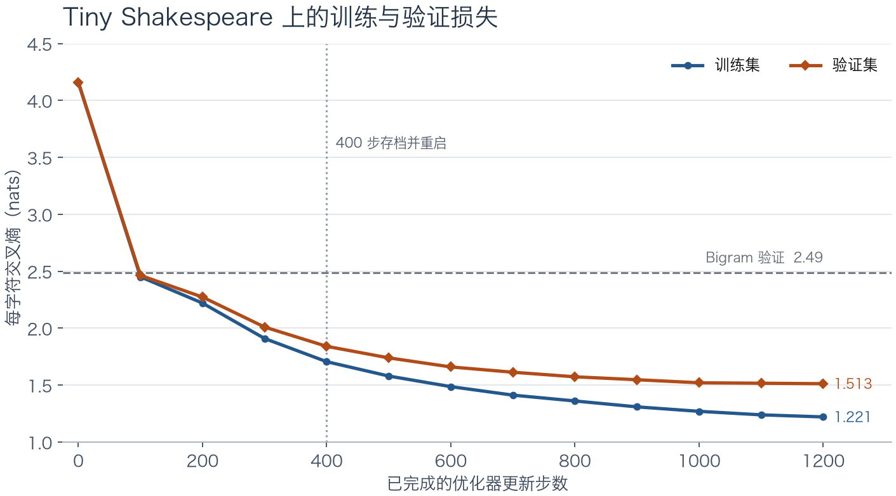

# 阶段 5：从零训练一个字符级 GPT

## 导读

前四个阶段我们搭好了 GPT-2，也借 OpenAI 的 124M 官方权重确认它算得对、能续写英文。但那个模型是别人训好的——这一阶段我们要从**完全随机的权重**出发，自己把一个迷你 GPT 训出来。

训练的核心动作跟阶段 0 的 bigram 一样：读到 `KING` 时，模型给词表里每个字符打分；对照原文里紧接着的正确答案 `:` 算出损失（loss），反向传播求出每个权重该怎么调，优化器推一步。一整段剧本里，每一个位置都是一道「猜下一个字符」的题。

这一阶段沿用[阶段 2 的 `GPT2`](02-model.md)（缩小到 6 层、384 维、6 头，约 1,080 万参数），以及[阶段 0 的字符表和 90% / 10% 语料切分](00-bigram.md#33-get_batch-代码逐行讲解)——让两个模型的 loss 同以「单个字符」为单位，可以比较两次运行的验证 loss。两次的模型结构和训练目标总数都有变化，因此降幅反映的是整体差异；最后再用[阶段 4 的生成函数](04-generation.md)看看它能不能自己写出像样的莎士比亚台词。

## 进度与验收

### 最终结果 从乱码到莎士比亚风格

2026-11-28 在 Colab **NVIDIA A100（40 GB）** 上，用 PyTorch `2.14.1+cu130` 和 BF16 混合精度（主权重保持 float32）从零训练了 1,200 步（每步 8,192 个字符目标，累计约 983 万个目标）。每 100 步在训练集和验证集各自的固定窗口上考一次试：

| 已完成步数 | 累计训练目标 | 训练 loss | 验证 loss |
|---:|---:|---:|---:|
| 0 | 0 | 4.1591 | 4.1558 |
| 100 | 819,200 | 2.4510 | 2.4636 |
| 400（存档并换进程续训） | 3,276,800 | 1.7061 | 1.8408 |
| 800 | 6,553,600 | 1.3611 | 1.5733 |
| 1,200 | 9,830,400 | **1.2210** | **1.5127** |



结果很直观：
- 验证 loss 从随机起点的 **4.16** 一路降到 **1.51**，比阶段 0 Bigram 的实测验证 loss（2.49）低了将近 **0.98 nats/字符**（`nats` 是用自然对数计算交叉熵时的单位；验证 loss 1.51 意味着模型给正确下一个字符分配的几何平均概率约 `exp(-1.51) ≈ 22%`，而刚初始化时只有约 1.5%，bigram 也只到约 8.3%）。
- 曲线后半段验证 loss 仍在缓慢下降，训练 loss 降得更快（1.22 vs 1.51），开始出现轻微过拟合的苗头。

训完后，只给一个换行符作开头，按 `temperature=0.8, top_k=20` 抽样续写 160 个字符，它已经能写出押韵节奏、人物称呼和标点断句（虽然偶尔还会造出 `proceedy`、`merchangy` 这种假词）：

```text
Fie, thou enjoy'd my face, and my more own proceedy.
But, my lord, I am live, son, in late:
Give God pate; I long with you speak: now, and the
merchangy abuse a
```

整次远端脚本（包含两段训练、断点核对、存档和生成）共跑了约 **98 秒**（算上传下载整次会话约 3 分钟，按当时 8.16 计算单元/小时估算约 **0.41 个计算单元**）。最终权重和日志回传保存在本地 `checkpoints/stage5-20261128/a100/`（由 Git 忽略）。

### 第 400 步的跨进程断点对照

云端训练随时可能断线，所以「暂停再接着训」必须靠谱。只看读档后那一刻的 loss 一致其实不够——如果漏存了优化器的动量、学习率进度或数据抽样位置，下一步更新就会跑偏。

为此我们在第 400 步做了一次严格的跨进程对照：第一个进程存完第 400 步断点后，顺手在内存里多跑一步（第 401 步）记下结果；第二个全新进程重新建模型和优化器、读入第 400 步断点，真正跑完第 401 到 1,200 步。打开 CUDA 确定性设置后，两边在第 401 步上的结果逐项吻合：

| 第 401 步核对项 | 连续训练 vs 读档续训 |
|---|---|
| 两个微批的输入与标签 | SHA-256 完全一致，抽样器前后状态也一致 |
| 当前学习率 | 同为 `0.0008085008613740311` |
| 本步平均 loss | 同为 `1.6742949485778809` |
| 更新后的模型权重与 AdamW 状态 | 最大绝对差为 **0**（验收门槛 `1e-6`） |
| CPU 与 CUDA 随机数状态 | 逐字节一致 |

把最终权重下载到 Mac 上，用 CPU float32 独立复算同一批评估窗口，得到训练 loss **1.2208**、验证 loss **1.5126**，与 A100 BF16 混合精度结果的绝对差分别约为 `0.00021` 和 `0.00012`。

### 带性能监控的 A100 复跑

首轮跑得很快，但我们还不知道这个 1,080 万参数的小模型到底有没有把 A100 喂饱。于是同一天在 **A100 80 GB** 上挂上监控，用完全相同的配置、种子和第 400 步跨进程断点再跑了一遍（最终验证 loss 同样精确复现为 **1.5127171**，第 400 步和第 1,200 步断点的文件指纹与首轮完全一致）：

| 监控指标 | 本轮实测 |
|---|---:|
| 更新阶段的 GPU 利用率（均值 / 峰值） | **40.4% / 45%** |
| 显存读写活跃率（均值 / 峰值） | 14.2% / 16% |
| 整卡功耗（均值 / 峰值 / 上限） | **144.9 W / 158.2 W / 400 W** |
| 整卡显存峰值（PyTorch 实际分配 / 缓存预留） | **1,482 MiB**（850.4 / 902.0 MiB） |
| 温度与典型频率（SM / 显存） | 37–45 °C，1,410 / 1,593 MHz |

1,200 次更新本身耗时 **56.73 秒**（**47.3 ms/步，约 17.3 万字符 token/秒**），评估、存盘和生成分别花 3.38、3.04 和 6.56 秒；整次会话约 106 秒，按 10.99 计算单元/小时估算约 **0.32 个计算单元**（日志存于 `checkpoints/stage5-20261128/a100-profile/`）。

这组读数给出了一个很实用的结论：**对这么小的模型，A100 远没跑满**——利用率只有四成、功耗不到上限四成、显存只用了 1.5 GB。具体空档是卡在取数据、同步还是小算子调度，会在阶段 6 的 A100 时间线剖析里拆开看。[NVIDIA 利用率指标定义](https://docs.nvidia.com/deploy/nvidia-smi/index.html#utilization)

### 上云前的本机验证

在花云端 GPU 时间之前，先在本机把所有训练逻辑测了个底朝天（原有 89 项 + 本阶段新增 10 项，共 **99 项单元测试全部通过**，并用独立参考实现复核）：

| 上云前检查 | Mac CPU | Mac MPS |
|---|---:|---:|
| 固定小样本初始 loss → 过拟合 100 步后 | `1.7050 → 0.000486` | `1.7549 → 0.000531` |
| 过拟合后预测正确的位置 | 8 / 8 | 8 / 8 |
| 连续 10 步 vs「5 步 + 读档 + 5 步」最大权重差 / loss 差 | `0 / 0` | `0 / 0` |

在这组小型续训对照里，CPU 上 AdamW 状态误差为 `0`，MPS 上最大差 `4.66e-10`（远低于 `1e-5` 容差）。此外也在 Mac MPS 上用正式的 1,080 万参数模型测了 6 步速度：第 1 步 1.25 秒，稳定后每步 0.33–0.35 秒（约是 A100 的 7 倍耗时）。

## 全景

训练代码拆成两个文件：[gpt2/training.py](../../gpt2/training.py) 放可复用的训练零件，[gpt2/train.py](../../gpt2/train.py) 负责把它们串成命令行入口；测试在 [tests/test_gpt2_training.py](../../tests/test_gpt2_training.py)。

| 章节 | 回答什么问题 |
|---|---|
| [1 数据与配置](#1-数据与配置) | 一次更新要看多少字符，训练和验证数据怎么切才不泄题？ |
| [2 损失和参数更新](#2-损失和参数更新) | 为什么要预热学习率、只衰减矩阵权重、做梯度累积和梯度裁剪？ |
| [3 评估与断点](#3-评估与断点) | 怎么公平对比不同步数的分数，断点里必须存哪些东西才能无缝续训？ |
| [4 完整训练入口](#4-完整训练入口) | 怎么在命令行一键从零训、分段续训，并查看耗时和 GPU 监控日志？ |

## 1 数据与配置

### 1.1 `TrainConfig`

```python
@dataclass(frozen=True)
class TrainConfig:
    """一次训练的固定设置。batch_size 是一次前向的段数，steps 是总更新次数。"""

    block_size: int = 256
    num_layers: int = 6
    num_heads: int = 6
    embedding_dim: int = 384
    batch_size: int = 16
    accumulation_steps: int = 2
    steps: int = 1200
    warmup_steps: int = 50
    peak_lr: float = 1e-3
    min_lr: float = 1e-4
    weight_decay: float = 0.1
    grad_clip: float = 1.0
    seed: int = 1337

    def __post_init__(self) -> None:
        """在分配模型或读取训练数据前检查窗口、批量和学习率日程。"""
        if min(self.block_size, self.batch_size, self.accumulation_steps) < 1:
            raise ValueError("block_size, batch_size and accumulation_steps must be positive")
        if not 0 <= self.warmup_steps < self.steps:
            raise ValueError("warmup_steps must be in [0, steps)")
        if not 0 < self.min_lr <= self.peak_lr or self.grad_clip <= 0:
            raise ValueError("expected 0 < min_lr <= peak_lr and positive grad_clip")
```

- **模型尺寸**：6 层、6 头、384 维（每头宽 `384 / 6 = 64`），上下文长度 `block_size = 256`。放在 65 个字符的词表上，总计 10,770,816 个参数，比 124M 小一个量级，但足够在 tiny Shakespeare 上拉开与 bigram 的差距。
- **有效批量**：每次前向读 `batch_size = 16` 段、每段 256 个目标；累积 `accumulation_steps = 2` 个微批再更新一次参数，相当于每步处理 `16 × 256 × 2 = 8,192` 个字符目标，1,200 步合计约 983 万个目标。
- **防错设计**：`frozen=True` 让配置在创建后不能被误改；`__post_init__` 在创建模型之前就把非法批量、学习率倒挂或非正裁剪阈值挡下来，避免跑了一半才报错。

### 1.2 `read_corpus`

```python
def read_corpus(path: Path, block_size: int) -> tuple[CharTokenizer, torch.Tensor, torch.Tensor, str]:
    """按阶段 0 的字符表编码，返回词表、两段一维 CPU long 张量和语料指纹。"""
    text = path.read_text(encoding="utf-8")
    cut = int(0.9 * len(text))
    if min(cut, len(text) - cut) <= block_size:
        raise ValueError("each split needs at least block_size + 1 characters")
    tokenizer = CharTokenizer(text)
    ids = torch.tensor(tokenizer.encode(text), dtype=torch.long)  # (N,)
    # 先分开再在每段内部抽窗口，最后一个训练目标也落在训练集。
    digest = hashlib.sha256(text.encode("utf-8")).hexdigest()
    return tokenizer, ids[:cut], ids[cut:], digest
```

1. 按顺序把前 90% 划作训练集、后 10% 划作验证集（不能先打乱字符顺序，否则不仅句子会被搅碎，还会把验证集相邻的片段漏给训练集）。因为每个样本需要 `T` 个输入加 1 个右移目标，两个分区各自至少要有 `block_size + 1` 个字符。
2. 沿用阶段 0 的 `CharTokenizer` 建固定编号表（tiny Shakespeare 共有 65 种字符），把整份文本编码成 CPU 上的一维 `torch.long` 张量。
3. 同时计算原文的 SHA-256 指纹 `digest` 存进断点：将来续训时如果换错了数据文件，哪怕文件名和长度碰巧相同，也能立刻被揪出来。
4. 后续 `get_batch` 只在各自分区内抽 `T + 1` 个连续字符（例如抽到 `KING:`，输入就是 `KING`，标签就是 `ING:`），保证训练集的最后一个目标也绝不会跨到验证集里。测试专门核对了验证集恰好 `T + 1` 和少一个字符的边界情况。

## 2 损失和参数更新

### 2.1 `learning_rate` 为什么要先预热再余弦衰减

```python
def learning_rate(step: int, config: TrainConfig) -> float:
    """第 step 次更新使用的学习率（从 1 计数）。线性预热后沿余弦降至 min_lr。"""
    if not 1 <= step <= config.steps:
        raise ValueError("step outside training schedule")
    peak_step = max(1, config.warmup_steps)  # 关闭预热时，第一步直接用峰值。
    if step <= peak_step:
        return config.peak_lr * step / peak_step
    progress = (step - peak_step) / (config.steps - peak_step)
    cosine = (1.0 + math.cos(math.pi * progress)) / 2.0
    return config.min_lr + (config.peak_lr - config.min_lr) * cosine
```

训练语言模型通常不会全程固定一个学习率，而是走 **warmup（线性预热）+ cosine（余弦衰减）**：

- **前 50 步线性预热**：刚开局时所有权重都是随机的，AdamW 对梯度波动的统计也还没站稳，如果第一步就迈出很大的步子，很容易把权重推偏甚至算崩。从小步子线性升到峰值 `0.001`，让梯度先稳住。
- **后 1,150 步余弦衰减**：到了中后期模型已经接近比较好的解，步子太大只会在谷底来回震荡。余弦曲线先缓后快再缓，把学习率平滑降到 `0.0001`，方便权重精细落位。

这里的 `step` 从 1 开始计数（表示即将执行的第几次更新）。如果把 `warmup_steps` 设为 `0`，`peak_step = max(1, 0) = 1`，第 1 步就会直接用峰值学习率。测试覆盖了第 1 步、峰值点、中点、终点和越界步号。

### 2.2 `make_optimizer` 为什么只对矩阵做权重衰减

```python
def make_optimizer(model: GPT2, config: TrainConfig) -> torch.optim.AdamW:
    """矩阵使用 AdamW 的权重衰减，偏置和归一化的一维参数只做梯度更新。"""
    # parameters() 会消除共享引用，token 表与输出层共享的矩阵只会更新一次。
    matrices = [p for p in model.parameters() if p.ndim >= 2]
    vectors = [p for p in model.parameters() if p.ndim < 2]
    groups = [
        {"params": matrices, "weight_decay": config.weight_decay},
        {"params": vectors, "weight_decay": 0.0},
    ]
    return torch.optim.AdamW(groups, lr=config.peak_lr, betas=(0.9, 0.95))
```

**权重衰减（weight decay）**会在每一步把参数轻轻往 0 拉一点，防止个别权重长得过大、死记硬背训练数据。但并不是所有参数都适合往 0 拉：

- **二维矩阵（`ndim >= 2`）**：线性层权重和 embedding 表，参数量占绝对大头，给它们加上 `weight_decay = 0.1`。
- **一维向量（`ndim < 2`）**：线性层偏置和 LayerNorm 的缩放/偏移参数。把 LayerNorm 的缩放系数硬往 0 拉会破坏归一化本身，偏置通常也很少导致过拟合，因此把它们的衰减设为 `0.0`。

另外两个细节：`model.parameters()` 会自动去重，所以 `wte` 和 `lm_head` 共享的那张表只会进组一次、更新一次；`betas=(0.9, 0.95)` 沿用 GPT-3 / nanoGPT 的常用设置，分别控制 AdamW 对梯度一阶均值（动量）和二阶平方均值（步长缩放）的记忆长度。测试逐个核对了每个参数的分组以及共享权重只出现一次。

### 2.3 `batch_loss`

```python
def batch_loss(model: GPT2, x: torch.Tensor, y: torch.Tensor) -> torch.Tensor:
    """输入和标签都是 (B,T)。返回这 B×T 个下一个 token 的平均负对数概率（标量）。"""
    device = model.embeddings.wte.weight.device
    # 在原生支持 bf16 的 CUDA 卡上只降低部分前向运算的精度，主权重仍是 float32。
    precision = nullcontext()
    if device.type == "cuda" and torch.cuda.is_bf16_supported(including_emulation=False):
        precision = torch.autocast("cuda", dtype=torch.bfloat16)
    with precision:
        logits = model(x.to(device))  # (B,T,V)，V 是词表大小。
    # y 是向后移动一格的目标。按同一顺序展平 B 和 T，保留 V 个类别。
    return F.cross_entropy(logits.float().flatten(0, 1), y.to(device).reshape(-1))
```

1. 从模型权重读取所在设备：CPU 和 Mac 上全程用 float32；如果是在原生支持 BF16 的 NVIDIA GPU（如 A100）上，则打开 `torch.autocast("cuda", dtype=torch.bfloat16)`，让耗时的矩阵乘法自动用 BF16 提速，而参数主副本和最终交叉熵仍保持 float32，兼顾速度和数值稳定。
2. 前向算出 `(B, T, V)` 的分数后，用 `flatten(0, 1)` 把前两维压平成 `(B × T, V)`——每一行就是一道「猜下一个字符」的题；`y.reshape(-1)` 按完全相同的顺序排成 `(B × T,)` 的正确答案。
3. 交叉熵对每道题取出正确答案的预测概率 `p`，算 `-ln(p)` 再求全批平均。比如猜中概率是 0.5 时 loss 约 0.693，升到 0.9 时降到约 0.105。测试用逐位置手算对数概率做对照，能立刻抓出标签多移一位或展平错轴的 bug。

### 2.4 `train_step` 与 `update_parameters` 梯度累积和梯度裁剪

```python
def train_step(
    model: GPT2, optimizer: torch.optim.Optimizer, data: torch.Tensor,
    sampler: torch.Generator, config: TrainConfig, step: int,
) -> float:
    """从训练集抽取等大的微批，累积平均梯度、裁剪并做一次更新，返回更新前的平均 loss。"""
    batches = (
        get_batch(data, config.block_size, config.batch_size, generator=sampler)
        for _ in range(config.accumulation_steps)
    )
    return update_parameters(model, optimizer, batches, config, step)


def update_parameters(
    model: GPT2, optimizer: torch.optim.Optimizer,
    batches: Iterable[tuple[torch.Tensor, torch.Tensor]], config: TrainConfig, step: int,
) -> float:
    """对 config.accumulation_steps 个等大的 (B,T) 微批做一次参数更新。"""
    model.train()
    rate = learning_rate(step, config)
    for group in optimizer.param_groups:
        group["lr"] = rate
    optimizer.zero_grad(set_to_none=True)
    losses = []
    for x, y in batches:
        loss = batch_loss(model, x, y)  # 每个微批都有 B×T 个有效目标。
        (loss / config.accumulation_steps).backward()
        losses.append(loss.detach())  # 只为日志保留标量，可释放这个微批的计算图。
    if len(losses) != config.accumulation_steps:
        raise ValueError("microbatch count differs from accumulation_steps")
    torch.nn.utils.clip_grad_norm_(model.parameters(), config.grad_clip, error_if_nonfinite=True)
    optimizer.step()
    return torch.stack(losses).mean().item()
```

这里拆成两个函数是有意为之：`train_step` 负责随机抽微批，真正的更新逻辑留在 `update_parameters` 里，这样阶段 6 换成顺序读取硬盘数据分片时可以直接复用。整步更新里有三个关键细节：

1. **为什么需要梯度累积？** 训练大模型时，我们希望每步更新看的样本够多（有效批量够大，梯度更稳），但显卡显存一次装不下整个大 batch。办法是把大 batch 拆成 `accumulation_steps` 个等大的**微批**：先在循环外清空梯度，然后逐个微批算 `loss / accumulation_steps` 并调用 `.backward()`。PyTorch 会把每次的梯度累加到 `.grad` 上；因为提前除了累积次数，全部微批加起来正好等于「一次性塞进整个大 batch 算平均 loss 再反传」的数学梯度，但显存里每次只需留一个微批的计算图（`loss.detach()` 把纯数值摘出来记日志，让计算图及时释放）。
2. **为什么需要梯度裁剪？** 训练中偶尔会遇到特别难或异常的片段，算出一个异常巨大的梯度，一步就把辛苦学好的权重推飞。`clip_grad_norm_(..., 1.0)` 把全网所有参数的梯度拼成一条总向量算长度（L2 范数）：如果超过 `1.0`，就把整组梯度按同一比例缩短到长度为 `1.0`（方向不变、步幅封顶）；`error_if_nonfinite=True` 还能在出现 `NaN` / `Inf` 时立刻报错停下。
3. **执行顺序不能乱**：设学习率 → 循环外 `zero_grad` → 微批循环里累积反传 → 循环外检查微批数并裁剪梯度 → `optimizer.step()` 真正改权重。

测试连续跑两步，和「一次性装入完整大 batch 的手工 SGD」逐元素比对（并专门构造了会触发梯度裁剪的样本），能精准抓出过早裁剪、清梯度放进微批循环内、或者忘记除以 `accumulation_steps` 的错误；另一项测试让模型在固定小样本上过拟合到 loss `< 0.02` 且全部预测正确。

## 3 评估与断点

### 3.1 `evaluate` 与 `evaluate_batches`

```python
def evaluate(model: GPT2, data: torch.Tensor, config: TrainConfig, batches: int) -> float:
    """用固定窗口估算一个数据分区的平均 loss；评估不消耗训练抽样器的状态。"""
    if batches < 1:
        raise ValueError("evaluation needs at least one batch")
    sampler = torch.Generator().manual_seed(config.seed + 1)
    windows = (
        get_batch(data, config.block_size, config.batch_size, generator=sampler)
        for _ in range(batches)
    )
    return evaluate_batches(model, windows)


@torch.no_grad()
def evaluate_batches(model: GPT2, batches: Iterable[tuple[torch.Tensor, torch.Tensor]]) -> float:
    """计算等大的 (B,T) 微批的平均 loss，并恢复调用之前的训练模式。"""
    was_training = model.training
    model.eval()
    try:
        losses = []
        for x, y in batches:
            losses.append(batch_loss(model, x, y))
        return torch.stack(losses).mean().item()
    finally:
        model.train(was_training)
```

评估要解决两个公平性问题：

1. **每次考同一套卷子**：`evaluate` 每次都在内部新建一个固定种子（`config.seed + 1`）的 CPU 抽样器，这样第 100 步和第 200 步测的是完全相同的 12 批窗口（49,152 个字符目标），曲线起伏来自模型本身而不是「这次抽到的题碰巧简单」。同时它不碰训练用的 `sampler`，不会打乱训练数据的抽样进度。
2. **考完不留痕迹**：`@torch.no_grad()` 关闭梯度记录；`was_training` 记下调用前模型所处的模式，临时切到 `model.eval()`，并用 `try ... finally` 保证就算中途报错也能把模式恢复原样。

### 3.2 `save_checkpoint`

```python
def save_checkpoint(
    path: Path, model: GPT2, optimizer: torch.optim.Optimizer,
    sampler: torch.Generator, config: TrainConfig, step: int,
    corpus_sha256: str, alphabet: str,
) -> None:
    """在完整更新之后保存。先写同目录临时文件，写完再替换上一个可恢复的断点。"""
    device = model.embeddings.wte.weight.device
    state = {
        "step": step, "config": asdict(config), "alphabet": alphabet, "corpus_sha256": corpus_sha256,
        "model": model.state_dict(), "optimizer": optimizer.state_dict(),
        "sampler_rng": sampler.get_state(), **capture_rng(device),
    }
    atomic_save(path, state)


def capture_rng(device: torch.device) -> dict:
    """保存 CPU 与当前计算设备的随机状态。"""
    state = {"cpu_rng": torch.get_rng_state(), "backend": device.type}
    if device.type != "cpu":
        state["device_rng"] = torch.get_device_module(device).get_rng_state(device)
    return state


def atomic_save(path: Path, state: dict) -> None:
    """先在同目录写完存档，再替换目标。中途失败保留上一份完整断点。"""
    path.parent.mkdir(parents=True, exist_ok=True)
    tmp = NamedTemporaryFile(dir=path.parent, delete=False)
    tmp_path = Path(tmp.name)
    try:
        with tmp:
            torch.save(state, tmp)
        tmp_path.replace(path)
    finally:
        tmp_path.unlink(missing_ok=True)
```

要做到「断线重连后和没断过一模一样」，存档里光放模型权重远远不够，还得把整套训练现场都打包进去：

- **进度与身份校验**：已完成的 `step`（决定下一步的学习率）、训练超参 `config`、字符表 `alphabet`（方便将来独立加载模型做续写），以及语料指纹 `corpus_sha256`。
- **模型与优化器状态**：`model.state_dict()` 存权重；`optimizer.state_dict()` 存 AdamW 累积的一阶动量和二阶方差——如果漏掉这一项，读档后 AdamW 会从零重新统计梯度历史，训练曲线立刻跳变。
- **数据进度与随机状态**：`sampler_rng` 存训练抽样器走到当前这一步的内部状态（只存初始种子会从第 1 批重新抽）；`capture_rng` 额外保存 CPU 和当前 GPU（CUDA / MPS）的随机状态，用 `**` 展开进字典。
- **原子写入（`atomic_save`）**：如果直接往旧断点文件里覆盖写，写到一半断电或磁盘满了，旧断点也会跟着毁掉。先在同目录写一个临时文件，写完再调用 `replace` 一步替换目标文件，哪怕中途失败，上一份完整断点也安然无恙；`finally` 负责清理残留的临时文件。

### 3.3 `load_checkpoint`

```python
def load_checkpoint(
    path: Path, model: GPT2, optimizer: torch.optim.Optimizer,
    sampler: torch.Generator, config: TrainConfig, corpus_sha256: str,
) -> int:
    """恢复权重、AdamW 和抽样位置，返回已完成步数。相同后端时也恢复设备随机状态。"""
    # 在 CPU 解包，随机数状态需保留为 CPU 字节张量；模型与优化器各自加载到参数设备。
    state = torch.load(path, map_location="cpu", weights_only=True)
    if state["config"] != asdict(config) or state["corpus_sha256"] != corpus_sha256:
        raise ValueError("training config or corpus differs from checkpoint")
    model.load_state_dict(state["model"])
    optimizer.load_state_dict(state["optimizer"])
    sampler.set_state(state["sampler_rng"])
    restore_rng(state, model.embeddings.wte.weight.device)
    return state["step"]


def restore_rng(state: dict, device: torch.device) -> None:
    """相同后端时恢复设备随机数，迁移设备时复用 CPU 状态。"""
    torch.set_rng_state(state["cpu_rng"])
    if device.type != "cpu" and device.type == state["backend"]:
        torch.get_device_module(device).set_rng_state(state["device_rng"], device)
```

读档时先在 CPU 上用 `weights_only=True` 安全解包（因为 PyTorch 要求随机数状态张量必须是 CPU 字节张量；之后 `model` 和 `optimizer` 的 `load_state_dict` 会各自把权重和状态搬到参数所在的设备上）。先核对配置和语料指纹完全一致，再依次恢复模型权重、优化器状态、数据抽样器和随机数状态，最后返回已完成步数——比如返回 `400`，外层循环就会从第 `401` 步接着往后走。

注意跨设备迁移时的处理：比如在 CUDA 上存的断点拿到 Mac CPU 或 MPS 上读取，`device.type != state["backend"]`，就只恢复 CPU 随机状态，不会强行把 CUDA 的随机数塞给 MPS。

## 4 完整训练入口

### 4.1 `run_training`

```python
def run_training(
    data_path: Path,
    checkpoint: Path,
    config: TrainConfig,
    device: torch.device,
    *,
    resume: bool = False,
    stop_after: int | None = None,
    eval_interval: int = 100,
    eval_batches: int = 12,
    monitor_gpu: bool = True,
) -> None:
    """训练到指定步数，记录耗时、评估 loss 并保存断点。CUDA 默认采集板卡读数。"""
    end = config.steps if stop_after is None else stop_after
    if not 1 <= end <= config.steps or min(eval_interval, eval_batches) <= 0:
        raise ValueError("invalid stop step or evaluation interval/batch count")
    if checkpoint.exists() and not resume:
        raise FileExistsError(f"{checkpoint} already exists; choose a new path or use --resume")
    tokenizer, train, val, digest = read_corpus(data_path, config.block_size)
    alphabet = tokenizer.decode(list(range(tokenizer.vocab_size)))
    torch.manual_seed(config.seed)
    if device.type == "cuda":
        torch.set_float32_matmul_precision("high")  # 剩余 float32 矩阵乘允许使用 TF32。
    # 直接在目标设备创建共享的 token 表，再把它交给优化器。
    with torch.device(device):
        model = GPT2(
            vocab_size=tokenizer.vocab_size,
            max_seq_len=config.block_size,
            embedding_dim=config.embedding_dim,
            num_heads=config.num_heads,
            num_layers=config.num_layers,
        )
    optimizer = make_optimizer(model, config)
    sampler = torch.Generator().manual_seed(config.seed)  # 独立 CPU 抽样器，状态即数据进度。
    start = 0
    if resume:
        start = load_checkpoint(checkpoint, model, optimizer, sampler, config, digest)
    if end < start:
        raise ValueError("stop step precedes the loaded checkpoint")
    tokens_per_step = config.batch_size * config.block_size * config.accumulation_steps
    metadata = {
        "device": str(device), "parameters": sum(p.numel() for p in model.parameters()),
        "train_chars": len(train), "val_chars": len(val), "vocab": tokenizer.vocab_size,
        "start_step": start, "tokens_per_step": tokens_per_step,
    }
    print(json.dumps(metadata), flush=True)

    # 从初始或恢复位置评估；之后的每行都对应已经完成该步更新的权重。
    run_metadata = dict(
        metadata, config=asdict(config), end_step=end, eval_interval=eval_interval, eval_batches=eval_batches,
    )
    with monitor_training(checkpoint, device, run_metadata, sample_gpu=monitor_gpu) as performance:
        started = time.monotonic()
        for step in range(start, end + 1):
            if step > start:
                with performance.measure("update", step):
                    train_step(model, optimizer, train, sampler, config, step)
            if step == start or step == end or step % eval_interval == 0:
                with performance.measure("evaluation", step):
                    train_loss = evaluate(model, train, config, eval_batches)
                    val_loss = evaluate(model, val, config, eval_batches)
                metrics = {
                    "step": step, "tokens_seen": step * tokens_per_step,
                    "lr": learning_rate(step, config) if step else 0.0,
                    "train_loss": train_loss, "val_loss": val_loss,
                    "elapsed_s": round(time.monotonic() - started, 3),
                }
                if step > start:
                    with performance.measure("checkpoint", step):
                        save_checkpoint(checkpoint, model, optimizer, sampler, config, step, digest, alphabet)
                print(json.dumps(metrics), flush=True)
                performance.record("progress", **(metrics | performance.timing()))
        if end == config.steps:
            with performance.measure("generation", end):
                model.eval()
                prompt = torch.zeros((1, 1), dtype=torch.long, device=device)  # (1,1)，0 是换行。
                sample = model.generate(prompt, 160, do_sample=True, temperature=0.8, top_k=20)
                text = tokenizer.decode(sample[0].tolist())
            print(json.dumps({"sample": text}), flush=True)
```

1. **区分「本次停在哪」和「总日程有多长」**：`stop_after` 控制这一次进程跑到第几步就停，而 `config.steps` 决定整条余弦学习率曲线的总步数。所以分段续训时学习率不会重头算起。另外如果目标断点文件已经存在却没传 `--resume`，函数会直接报 `FileExistsError`，防止手滑把辛辛苦苦训好的存档覆盖掉。
2. **先放对设备再建优化器**：用 `with torch.device(device):` 直接在目标设备上创建 `GPT2`，再交给 `make_optimizer`，避免优化器登记到旧设备上的张量。在 CUDA 上顺手打开 `TF32` 加速剩余的 float32 矩阵乘法。
3. **主循环**：`range(start, end + 1)` 包含了起点和终点。第一次（`step == start`）不做更新，先测一次初始或刚读档出来的 loss；之后每一步做一次 `train_step`，每隔 `eval_interval` 步（以及最后一步）评估一次、保存最新断点，并把每行指标以 JSON 打到终端（`flush=True` 保证云端日志实时可见）。外层挂着的 `monitor_training` 是和阶段 6 共用的轻量计时与 GPU 监控上下文，不影响训练本身。
4. **收尾试写**：跑满 `config.steps` 后，以编号 `0`（换行符）为开头，调用阶段 4 的采样器续写 160 个字符，直观检验模型学到了什么。

入口测试在 CPU 上用同一条总日程分别跑「连续 4 步」和「2 步 + 读档 + 2 步」，逐项核对最终存档完全一致。

### 4.2 `main` 与复现命令

```python
def main() -> None:
    """解析命令行并选用 CUDA、MPS 或 CPU。--resume 要沿用首次训练的语料和超参数。"""
    defaults = TrainConfig()
    parser = argparse.ArgumentParser(description=__doc__)
    parser.add_argument("--data", type=Path, default=Path("data/input.txt"))
    parser.add_argument("--checkpoint", type=Path, default=Path("checkpoints/shakespeare.pt"))
    parser.add_argument("--resume", action="store_true")
    parser.add_argument("--stop-after", type=int, help="本次运行的最后一步，保留 --steps 的学习率日程")
    parser.add_argument("--steps", type=int, default=defaults.steps)
    parser.add_argument("--warmup-steps", type=int, default=defaults.warmup_steps)
    parser.add_argument("--batch-size", type=int, default=defaults.batch_size, help="单个微批的段数")
    parser.add_argument("--accumulation-steps", type=int, default=defaults.accumulation_steps)
    parser.add_argument("--eval-interval", type=int, default=100)
    parser.add_argument("--eval-batches", type=int, default=12)
    parser.add_argument("--device", choices=("cuda", "mps", "cpu"))
    parser.add_argument("--no-gpu-monitor", action="store_true", help="关闭 NVIDIA 板卡采样，仍记录耗时与 CUDA 显存峰值")
    args = parser.parse_args()
    device = args.device
    if device is None:
        if torch.cuda.is_available():
            device = "cuda"
        elif torch.backends.mps.is_available():
            device = "mps"
        else:
            device = "cpu"
    config = TrainConfig(
        steps=args.steps, warmup_steps=args.warmup_steps,
        batch_size=args.batch_size, accumulation_steps=args.accumulation_steps,
    )
    run_training(
        args.data, args.checkpoint, config, torch.device(device),
        resume=args.resume, stop_after=args.stop_after,
        eval_interval=args.eval_interval, eval_batches=args.eval_batches, monitor_gpu=not args.no_gpu_monitor,
    )
```

`main()` 用 `argparse` 解析命令行参数，不指定 `--device` 时按 `cuda → mps → cpu` 自动选择设备。如果显存紧张，可以把 `--batch-size` 调小、把 `--accumulation-steps` 成倍调大，就能在保持总有效批量不变的前提下降低显存占用。

准备好与阶段 0 相同的 `data/input.txt` 后，在仓库根目录运行下面两条命令，就能复现「先跑 400 步 → 读档跑到 1,200 步」的完整流程（想一口气跑完就去掉 `--stop-after 400`；在 Mac 上把 `cuda` 换成 `mps`）。[tiny Shakespeare 数据源](https://github.com/karpathy/char-rnn/tree/master/data/tinyshakespeare) · [参考小模型配置](https://github.com/karpathy/nanoGPT/blob/3adf61e/config/train_shakespeare_char.py)

```bash
python -m gpt2.train --device cuda --checkpoint checkpoints/shakespeare.pt --stop-after 400
python -m gpt2.train --device cuda --checkpoint checkpoints/shakespeare.pt --resume
python -m unittest discover -s tests -p test_gpt2_training.py -v
```

### 4.3 查看性能记录

为了给阶段 6 的性能优化铺路，训练入口在断点旁边顺手记了一份性能日志，位置在 `<断点文件名>.performance/step-<起始步>-<随机后缀>/`（分段续训两段会各自生成一个目录，互不覆盖；这只是观测日志，续训本身不依赖它）：

- **`training.jsonl`**：记录起止配置、每次评估时的 loss、累计耗时和更新吞吐（按「本段总训练目标数 ÷ 更新阶段总秒数」计算），结束行在 CUDA 上额外记下 PyTorch 显存分配峰值和缓存预留峰值。
- **`gpu.jsonl`（仅 CUDA）**：每秒通过 `nvidia-smi` 记录一次 GPU 利用率、显存读写活跃率、显存占用、功耗、温度和时钟频率（按设备 UUID 选卡，避免 CUDA 逻辑编号和物理编号不一致），并顺带标出当时正处于哪个训练阶段（注意驱动的利用率反映的是最近一个采样窗口的平均忙碌比例，不是某一微秒的瞬时值）。[NVIDIA 采样指标定义](https://docs.nvidia.com/deploy/nvidia-smi/index.html#utilization)

在 CPU、MPS 或找不到 `nvidia-smi` 的环境里，日志照常保留各阶段耗时，不会影响训练；也可以传 `--no-gpu-monitor` 单独关掉 GPU 轮询。[监控实现](../../gpt2/performance.py)

## 回顾

这一阶段把前面四段零件真正串成了一套能从零学习的系统：字符表编码文本、GPT-2 逐位置打分、交叉熵算出可微损失；再用预热 + 余弦学习率、分组权重衰减的 AdamW、梯度累积和梯度裁剪一步步更新权重，配合固定窗口验证和原子化的完整断点。1,080 万参数的小模型在 A100 上跑了不到两分钟，验证 loss 就从 4.16 降到 1.51，大幅超越 bigram，也验证了跨进程断点续训完全无损。下一阶段，我们就针对刚刚看到「GPU 只用到 40%」的问题，逐项做性能剖析与加速，并从零预训练 124M 基线。

## 延伸问答

### Q5.1 练这个小模型会不会把后面训练 124M 的额度用掉？

**A：** 几乎不会。训练花多少额度取决于模型参数量、总共看多少 token 和显卡费率。这里只有约 1,080 万参数、看 983 万个字符目标，在 A100 上不到两分钟就跑完了，估算只花 **0.3–0.4 个计算单元**；而阶段 6 的 124M 基线计划看 100 亿个 token，差了几个数量级。拿这零点几个单元先在云端把训练、存档、续训和监控流程全部踩顺，非常划算。

### Q5.2 做可解释神经元的研究，还要把这个模型重新训练几遍吗？

**A：** 不需要。候选方向 C 的第一步验证直接拿现成的官方 124M 权重就能做，完全不用训练。之后如果想追踪神经元在预训练第几步形成，只要在阶段 6 跑 124M 基线时按对数间隔额外留存历史权重快照就行；本阶段的 `shakespeare.pt` 是用来断点续训的，只保留最新一步的完整状态。

### Q5.3 首轮 A100 训练用了哪些加速？能看出 GPU 跑满了吗？

**A：** 首轮只开了 CUDA 的 BF16 混合精度（线性层等矩阵乘法用 BF16，主权重、AdamW 状态和交叉熵保持 float32）以及剩余 float32 矩阵乘的 TF32，注意力还是阶段 2 手写的版本，没有开 FlashAttention 或 `torch.compile`。[PyTorch 矩阵乘法精度说明](https://docs.pytorch.org/docs/stable/generated/torch.set_float32_matmul_precision.html)

按 `metrics.jsonl` 里两段实际评估之间的耗时算（第 0–400 步 20.63 秒，第 400–1,200 步 40.86 秒），合计 61.49 秒，平均每步 51.2 毫秒，吞吐约 **16.0 万字符 token/秒**（含中途评估和存盘）。但单看吞吐量无法判断 A100 跑没跑满，首轮也没挂监控；所以后来我们在 A100 80 GB 上补跑了带监控的一轮，看到更新阶段 GPU 利用率均值只有 **40.4%**、功耗不到上限四成，确认还有很大的加速空间。[带性能监控的 A100 复跑](#带性能监控的-a100-复跑)

## 术语表

| 术语 | 在本实验里的意思 |
|---|---|
| 微批 / 有效批量 | 每次前向实际送进显存的 `16` 段叫微批；累积 `2` 个微批再更新，相当于一次看 `32` 段的有效批量。 |
| 交叉熵 | 正确答案预测概率的负自然对数 `-ln(p)`，在整批所有目标上取平均，越小说明猜得越准。 |
| nats | 以自然对数（底数 `e`）算交叉熵时的单位；loss 等于 `L` 对应几何平均概率 `exp(-L)`。 |
| 泛化 | 模型在没用来更新权重的验证集文本上依然能预测得准，而不是死记训练集。 |
| 权重衰减（weight decay） | 更新参数时把矩阵权重轻轻往 0 拉一点，用来抑制过拟合；偏置和 LayerNorm 向量通常不做衰减。 |
| AdamW | 根据梯度的一阶均值（动量）和二阶平方均值自适应调步长、并把权重衰减解耦出来的优化器。 |
| 预热 / 余弦衰减 | 学习率先线性升高（warmup），再沿余弦曲线平滑降到最小值（cosine decay）。 |
| 梯度裁剪 | 当全网梯度的总长度超过阈值时，按同一比例整体缩短，防止单步异常梯度把权重推崩。 |
| BF16 混合精度 | 用 16 位脑浮点数加速矩阵乘法，同时把参数主副本、优化器状态和交叉熵保留在 32 位浮点数。 |
| 随机数状态 | 随机数生成器走到当前时刻的内部快照，恢复后可以无缝接续同一串随机抽样。 |
| checkpoint | 足以把训练原样接下去的完整存档，包含模型权重、优化器状态、步数、配置和随机状态。 |
